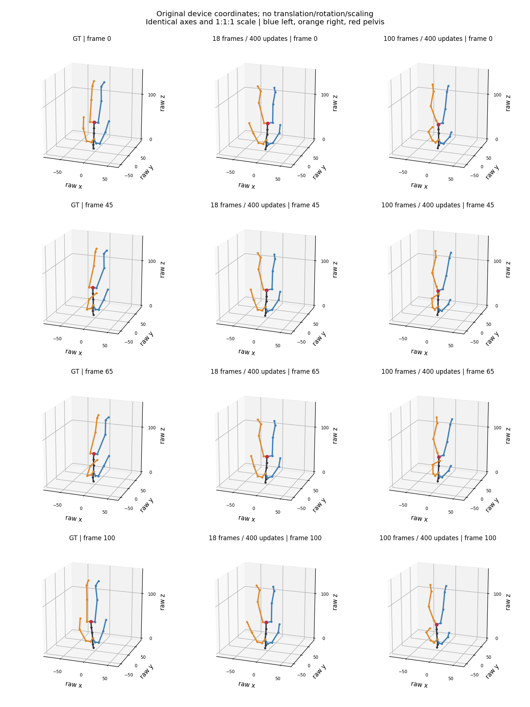
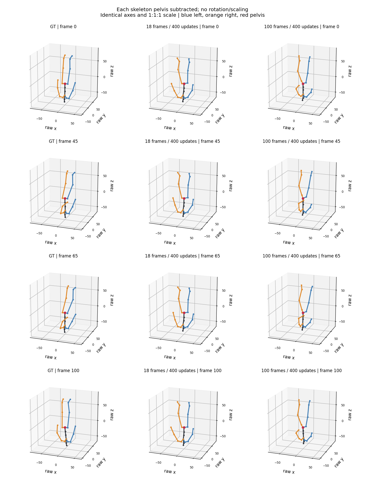
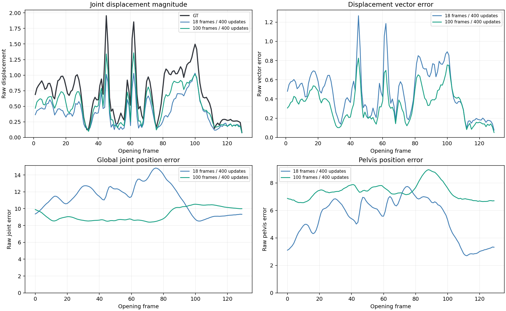
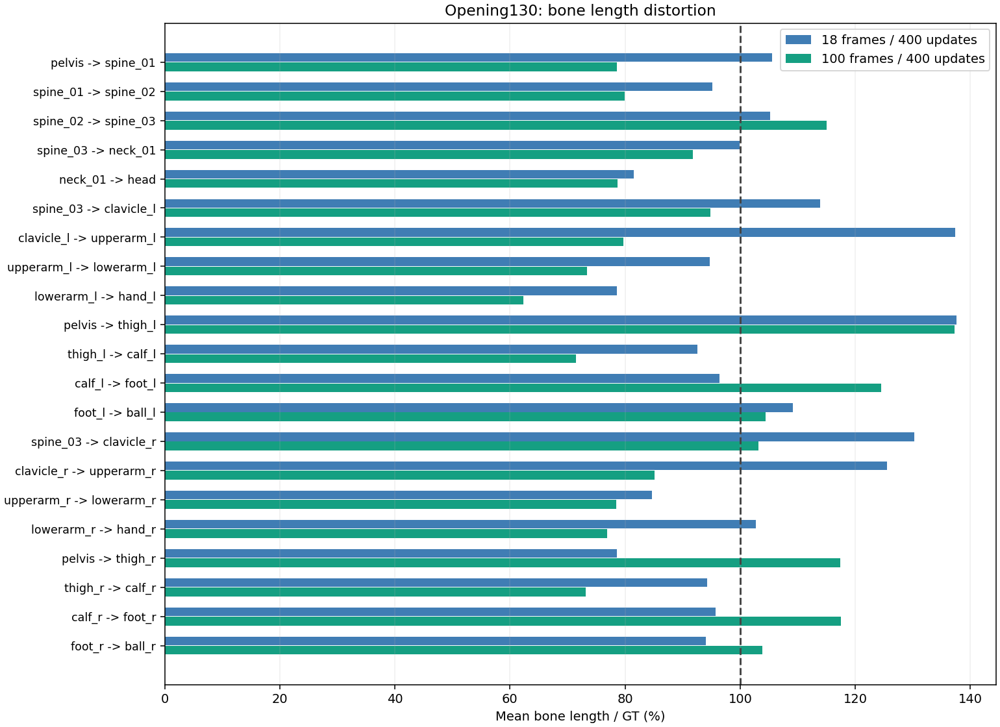
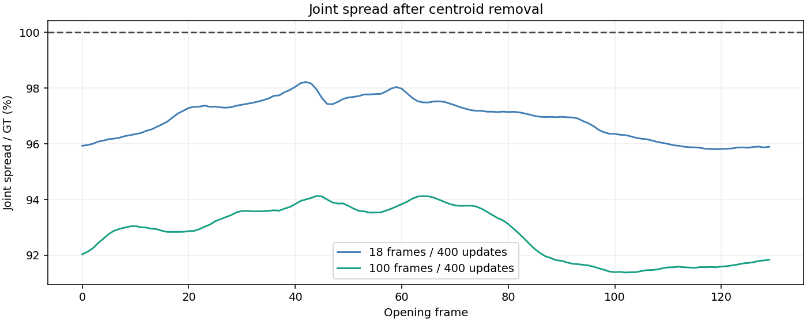
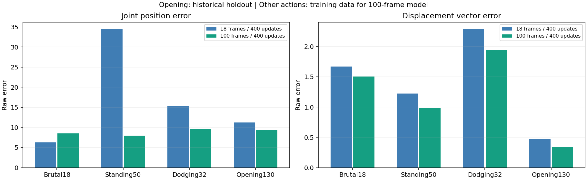
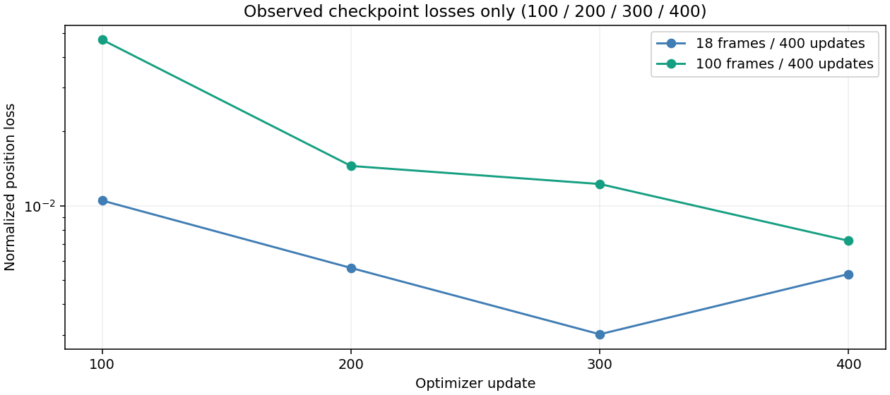

# M2 Dataset Scaling 100 — 실제 T4 비교 결과

2026-11-16. **실제 학습·평가 PASS / 개선 품질 PARTIAL / 전체 T4 결과 파일 회수 PASS**.

동일한 초기 모델을 18프레임과 100프레임으로 각각 400 updates 학습했다. Opening130에서 Joint Error 17.54%, Root-relative Error 18.73%, 이동 벡터 오차 28.52% 감소와 움직임 방향 개선을 관측했다. 그러나 Pelvis Error 36.51% 증가, 뼈 길이 축소와 관절 퍼짐 악화가 동반됐다. 100프레임 모델을 모든 면에서 우수한 모델로 채택할 근거는 부족하다.

## 1. 증거와 판정 범위

| 항목 | 상태 | 근거 |
|---|---|---|
| 입력 100개·호환성 검증 | PASS | 고유 frame key 100개, 서로 다른 pose SHA 100개, 기존18 텐서 완전 일치 |
| 실제 T4 학습 | PASS | Tesla T4, FP32, 두 군 각각 정확히400 updates·3200 anchor samples, 실행 종료 코드0 |
| 실제 Opening 평가 | PASS | DDIM10/seed10043, 두 실제 예측 NPZ 확보·SHA 검증·36개 지표씩 재계산 일치 |
| 과거 Control400 대비 Opening Train18 | PASS (파일 SHA-256) | 신규 NPZ의 SHA-256이 기준 커밋의 Control400 NPZ 기록과 일치. 별도 원본 NPZ를 연 배열 대조는 NOT VERIFIED |
| 사전 고정 품질 판정 | PARTIAL | 8개 조건 중5개 통과, Pelvis·bone distortion·spread 조건3개 실패 |
| 전체 T4 원본 결과 회수 | PASS | 원본 ZIP 31개 항목 CRC 및 29개 내부 SHA 검증. 양쪽 400-update checkpoint, 전체 로그·trace와 8개 NPZ 회수 |
| 독립 Test 일반화·통계적 유의성 | NOT VERIFIED | 단일 seed, 반복 분석된 Historical Holdout, 독립 motion 검증 미실시 |

Colab의 기존 출력에서 전체 원본 ZIP을 회수했다. 저장된 예측으로 지표를 재계산했고 체크포인트를 CPU에서 읽어 상태를 확인했다. 항목별 증거는 [결과 검증 JSON](metrics/t4/result_validation.json)에 기록했다.

## 2. 고정 소스·데이터

- 사용자 Fork: https://github.com/darkkyoung/REWIND-like-prototype
- 기준 커밋: `635d9424878cae2a031efc14588eb80a45b25391`
- 작업 브랜치: `experiment/m2-dataset-scaling-100-20261116`
- 실제 T4 실행 소스: `6ccf0ab650a225ec0c823b9ff030ce19c5a7dc84`. 후속 보고·그림 코드는 결과 후처리이며 학습 소스 변경이나 재학습이 아니다.
- [실제 실행 Colab](https://colab.research.google.com/drive/1LWMrpQyCEUCwqHp11aaVHsc3IU37WlCL)

| 동작 | 프레임 번호 | 수 | 출처와 역할 |
|---|---|---:|---|
| Brutal_Assassination | 0–17 | 18 | 기존 `M2_verified_148_input.zip` Train18 그대로 |
| Standing_Up__1_ | 0–49 | 50 | cache manifest train, `part-0000.zip` |
| Dodging | 0–31 | 32 | cache manifest train, `part-0005.zip` |
| Opening | 0–129 | 130 | 기존 Historical Holdout, 학습 제외 |

신규82개는 manifest의 train만 선택했다. 대체 동작은 사용하지 않았다. `selected_frames.csv`가 전체100개 정확한 경로·원본 SHA 목록이며 순서를 향후300/500/700/900 확장의 고정 prefix로 유지할 수 있다. 신규 확대 학습은 이번에 실행하지 않았다.

이전 입력 준비에서 Drive raw_cache의 manifest와 두 ZIP(합계 224,798,795 bytes)을 확보해 archive와 선택 pose/RGB의 SHA 및 RGB 1024×1024 헤더를 점검했다. 이번에는 보존된 manifest와 Pose JSON 100개를 대조했다. 선택 RGB의 원본 바이트와 전체 캐시 재검증은 NOT VERIFIED다. M2 입력은 Pose JSON의 Stereo2D 주석이다.

| 입력 | SHA-256 |
|---|---|
| 기존 `M2_verified_148_input.zip` | `184967a9732702fc0459350974b87e67f6499144dcfdbec48b18cb657805d74d` |
| 기존 Train18 NPZ | `2eab2d6426aea0340a5f0d8624ae9e199ad66c917fe2f2905c5d928186f1d1ef` |
| cache_manifest.json | `caa0956d4432e93fa2f257a7176f568fd50863819b1d2ada93b040ca8e8cee7e` |
| part-0000.zip | `058a7264bf7658a913878ded7724b670874a4f7e5cf2ed0ee8f28159a1d2a4ae` |
| part-0005.zip | `4a34e9f34c58e1f65c33df1d5c8c615ffe80b22f71499e458b521d26ac8c2d72` |
| GPU 입력 ZIP | `9145430464cbd44b1bb220ea93545b0015a7f8a4d02e63a940b489618bd623f3` |

기존 adapter로 재구성한 Train18의 features/target/mask/time/sequence/frame IDs는 원본과 완전히 같다. 새 Train100의 첫18개도 동일하다. Body22 순서, GT Stereo2D 관절별14 feature, pixel scale1024, target scale100 raw, zero-camera, causal window8을 유지했다. 시퀀스마다 window를 초기화하며 미래·padding·frame gap을 검증했다.

원본 world→camera→device 변환을 그대로 대조했고 학습 좌표를 보정하지 않았다. 최대 world→camera 잔차9.95e-14 raw, camera→device5.68e-14 raw로 저장된 변환식과 일치했다. 서로 다른 인물의 GT 평균 bone length 차이는 좌표 단위 불일치로 간주하지 않았다. 유효22관절은 모두 finite다. 물리 단위와 capture FPS는 미검증이며 mm·초당 속도로 표현하지 않는다.

Opening과 frame key, pose SHA, 정확한 pose/feature 중복과 motion 이름 중복은0이다. 기존18의 공식 split은 이번 캐시에 없어 독립 재검증하지 못했고 사용자가 지정한 Train18을 보존했다. 원본 mocap의 독립성, 전체 cache의 timestamp/stereo sync/영상 정합성은 완전히 입증하지 못했다. 이번 검증을 전체 데이터셋 학습 준비 완료로 확대 해석하지 않는다.

## 3. 공정한 두 군 실행

Body22, hidden64, graph1, temporal2, heads4, window8, dropout0, FP32, batch8, 기존 Position Loss, Adam lr0.001, StepLR200/gamma0.5, diffusion1000의 beta0.0001→0.02, DDIM10을 고정했다. 새 Frame Displacement Loss를 넣지 않았다.

두 군 모두 seed43의 신규 초기 모델에서 시작했다. 기존300/Control400/Improved400 checkpoint를 초기값으로 쓰지 않았고 A를 B에 이어 학습하지 않았다. 초기 model/optimizer/scheduler/RNG hash, diffusion timestep/noise trace hash가 저장된 실행 보고서에서 일치한다. 데이터 크기가 달라 실제 anchor ID열은 다르다. 각 군400 updates, 총3200 anchor draws이며100개 모두 최소21회·최대47회 선택됐다. 평균 노출은 기존18의177.78회에서100의32회로 감소했다.

동일 평가 초기 noise SHA가 두 군에서 일치한다. 두 모델의400-update 종료본 저장 후에만 네 동작을 평가했다. 100/200/300 checkpoint나 Holdout으로 모델·설정을 고르지 않았다. 저장된 전체 trace 400행씩에서 순서, anchor 빈도와 SHA-256을 다시 계산했다. 두 군의 diffusion timestep/noise trace 해시와 평가 noise 해시가 각각 일치했다.

환경: Python3.13.16 / PyTorch2.14.1+cu130 / CUDA13.0 / Tesla T4. 실제 arm 학습·checkpoint 저장 시간은18군17.97초,100군16.86초, 학습+평가 wrapper69.32초였다. 전체 데이터 준비·다운로드·검증 시간이나 end-to-end 서비스 속도가 아니다. 유료 GPU나 대규모 추가 학습을 실행하지 않았다.

사전 로컬 검증은 scaling9개+metrics2개=11개, M2 회귀10개 통과했다. Colab의 최초 `tests.test_m2` module import는 namespace 충돌로 실패했고 그 시점 optimizer update는0이었다. `unittest discover`로 동일 M2/metrics12개가 통과한 후 두 군 학습을 한 번 실행했다. 실패 cell과 성공 cell 모두 실행 notebook에 보존했다.

## 4. Opening130 정량 비교

오차는 raw, 비율은%다. 비율은100에 가까울수록 GT 크기와 일치한다.

| 지표 | 18-frame / 400 | 100-frame / 400 | 변화 |
|---|---:|---:|---:|
| Global Joint Position Error | 11.2621 | 9.2867 | -17.54% |
| Root-relative Joint Error (22) | 10.1958 | 8.2862 | -18.73% |
| Frame Displacement Vector Error | 0.4741 | 0.3389 | -28.52% |
| Motion Magnitude Ratio (%) | 58.4258 | 73.0776 | +14.65 pp |
| Root-relative Motion Ratio (%) | 35.6355 | 54.0807 | +18.45 pp |
| Bone Length Ratio (%) | 98.0752 | 88.7800 | -9.30 pp |
| Joint Spread Ratio (%) | 96.9184 | 92.7860 | -4.13 pp |
| Pelvis Position Error | 5.3995 | 7.3709 | +36.51% |

전신이 한 점으로 무너지는 collapse는 관측되지 않지만 형태 보존은 악화됐다. 평균 bone ratio만으로 왜곡이 상쇄될 수 있으므로 모든 frame·edge의 `mean(abs(pred_length/gt_length−1))×100`도 평가했다:13.5460→19.0772 pp(+5.5312pp). 최소 한 edge/frame 비율은74.9942→50.8479%다. 왼쪽 forearm→hand 평균62.2871%, 왼쪽 thigh→calf71.4402%, 반대로 pelvis→left thigh137.2698%로 단순 균일 축소가 아니다.

사전 `config.json`의 판정은 JPE/RR/FDE 감소, 두 motion ratio의100 접근, pelvis 상대악화≤2%, bone distortion 증가≤2pp, spread의100과 거리 증가≤2pp이다. 앞5개는 PASS, 뒤3개는 FAIL이므로 종합 **PARTIAL**이다. 이 규칙은 실제 결과를 보기 전 실행 소스 커밋에 고정했다.

지표 정의는 기존 진단과 동일하다. Joint Error는 valid joint의 Euclidean 거리 평균, RR22는 각 skeleton의 pelvis를 뺀22관절 평균(0인 pelvis 포함), Pelvis Error는 root 자체 거리다. FDE는 실제 연속 프레임 사이 `norm((P_t−P_(t−1))−(G_t−G_(t−1)))` 평균이다. Motion Ratio는 예측 변위 norm 평균/GT 변위 norm 평균이며 RR Motion은 pelvis를 뺀 nonroot21관절을 사용한다. Bone Length Ratio는 전체 valid21 edge의 평균 길이끼리의 비율이다. Joint Spread는 프레임마다 관절 centroid를 제거한 RMS 반경의 평균끼리의 비율이다. Joint/edge/temporal mask와 gap 검사를 적용하고 동작별로 분리 계산해 시퀀스 경계 변위를 포함하지 않는다. 상세 분모·비평균 비율·21관절 RR 오차도 CSV에 보존한다.

## 5. 움직임의 방향·상대 움직임·평균 자세

| 보조 지표 | 18군 | 100군 | 해석 |
|---|---:|---:|---|
| 이동 벡터 평균 cosine | 0.7710 | 0.8260 | 방향 일치 개선 |
| 이동 벡터 평균 각도 | 34.8901° | 27.5687° | 각도 오차 감소 |
| 팔 Root-relative FDE raw | 0.4414 | 0.3581 | 18.87% 감소 |
| 다리 Root-relative FDE raw | 0.5571 | 0.3525 | 36.73% 감소 |
| 팔 Root-relative Motion % | 48.5055 | 56.8908 | 여전히 움직임 과소 |
| 다리 Root-relative Motion % | 17.2834 | 50.4427 | 크게 개선하나 과소 |
| RR 시간 변화 pose RMS / GT % | 44.8239 | 60.3972 | 평균 자세에 머무는 경향 완화 |
| RR 시간평균 제거 자세 오차 raw | 4.6306 | 3.2348 | 동적 성분 개선 |
| RR 시퀀스 평균 자세 편향 raw | 9.2315 | 7.3279 | 정적 평균 자세 편향도 감소 |

방향 평가는 GT와 예측 변위 norm이 모두1e-6보다 큰 valid 연속 pair만 사용한다. 팔은 clavicle~hand 양측8관절, 다리는 thigh~ball 양측8관절이다. 보조 지표는 원인 설명에 사용하며 사전8개 판정 중 실패한 항목을 대체하지 않는다. 100개 학습은 데이터 수와 동작·인물 다양성을 함께 바꾼다. 이 결과만으로 순수 프레임 수 효과, 특정 원인, 통계적 유의성을 분리해 입증할 수 없다.

## 6. 동작별 결과와 부작용

| 동작 | 모델 | Joint Error | RR Error | FDE | Motion % | RR Motion % | Bone % | Spread % | Pelvis Error |
|---|---|---:|---:|---:|---:|---:|---:|---:|---:|
| train18 | train18 | 6.3070 | 4.7262 | 1.6697 | 48.0848 | 45.5720 | 97.1251 | 98.3972 | 3.7947 |
| train18 | train100 | 8.5459 | 9.0156 | 1.5050 | 55.9262 | 52.0401 | 86.5122 | 93.8239 | 6.9008 |
| standing50 | train18 | 34.4706 | 33.4613 | 1.2238 | 52.1339 | 43.4154 | 101.1215 | 123.8537 | 9.3797 |
| standing50 | train100 | 7.9170 | 8.9113 | 0.9864 | 87.1090 | 80.6016 | 87.6161 | 95.8052 | 5.4832 |
| dodging32 | train18 | 15.2842 | 14.6503 | 2.2893 | 63.3127 | 53.5635 | 92.5399 | 102.6742 | 7.1204 |
| dodging32 | train100 | 9.5178 | 10.0906 | 1.9445 | 70.0505 | 57.1377 | 83.7123 | 98.8649 | 6.3112 |
| opening130 | train18 | 11.2621 | 10.1958 | 0.4741 | 58.4258 | 35.6355 | 98.0752 | 96.9184 | 5.3995 |
| opening130 | train100 | 9.2867 | 8.2862 | 0.3389 | 73.0776 | 54.0807 | 88.7800 | 92.7860 | 7.3709 |

Brutal18은 두 군 모두의 학습 동작이다. 데이터 확대 후 이 동작의 Joint/RR/Pelvis 오차가 악화됐다. 고정 학습량에서 기존 동작의 노출이 줄고 동작·인물별 자세를 함께 맞추는 효과와 양립하지만 단일 실험으로 원인을 확정하지 않는다. Standing/Dodging은100군의 학습 데이터이므로 해당 개선을 독립 일반화 증거로 쓰지 않는다. 세 학습 동작 전체의 비율을 단순 평균해 pooled metric인 것처럼 보고하지 않았다.

Brutal18의100군 최소 edge/frame 길이는39.73%, Standing45.92%, Dodging44.54%로 일부 부위의 심한 축소가 있다. Brutal18 두 NPZ도 회수했다. 네 동작과 두 모델의 NPZ 8개에서 36개 지표씩 재계산해 저장 CSV·JSON과 일치함을 확인했다. 지표 비교에 사용한 절대 및 상대 허용치는 각각 1e-12다.

별도 미사용 동작 평가는 하지 않았다. 추가 ZIP 전체나 validation/test를 학습에 넣지 않았고 같은 Dodging의 남은 프레임을 독립 Test로 주장하지 않는다.

## 7. 어느 프레임에서 달라졌는가

Opening의129개 연속 구간 중121개는 이동 벡터 오차가 줄고8개는 늘었다. frame 번호는 변위 구간의 끝 프레임이다.

| 구간 끝 frame | 18군 FDE | 100군 FDE | 변화 |
|---|---:|---:|---|
| 62 | 1.1861 | 0.6984 | 가장 큰 감소 |
| 45 | 1.2674 | 0.8254 | 감소 |
| 61 | 1.0568 | 0.6733 | 감소 |
| 106 | 0.3528 | 0.4081 | 가장 큰 증가 |
| 105 | 0.3635 | 0.4150 | 증가 |
| 107 | 0.3742 | 0.4184 | 증가 |

`opening_frame_analysis.csv`에 전체 프레임의 Joint/RR/Pelvis/FDE/Spread/Bone를 보존했다.0/45/65/100의 실제 skeleton과130개 전체 프레임 GIF는 동일한 axes와1:1:1 축척을 사용한다. Global 그림에서는 GT 위치에 맞추는 이동·회전·스케일 보정을 하지 않았다. 별도 root-relative 그림만 각 skeleton 자신의 pelvis를 뺐다. 화면에서 신체가 뒤집혀 보여도 device 좌표의 방향을 미관상 회전 보정하지 않았다.













GIF는 `opening_comparison_motion.gif`, `opening_train18_motion.gif`, `opening_train100_motion.gif`이며 각130프레임이다. 표시10fps는 재생 편의 설정일 뿐 원본 capture FPS가 아니다.

## 8. 학습 Loss와 checkpoint

이 표와 그림은 실행 notebook stdout의 100/200/300/400 시점 실제 배치 loss다. 전체 400-step 기록은 [Train18 CSV](metrics/t4/train18_training.csv)와 [Train100 CSV](metrics/t4/train100_training.csv)에 있다. 원본 JSONL은 개인 전달본에 포함했다. CSV와 JSONL의 각 행 및 콘솔 관측점 8개를 대조했다.

| 모델 | Update | 관측 batch Position Loss |
|---|---:|---:|
| train18 | 100 | 0.010498593 |
| train18 | 200 | 0.005607970 |
| train18 | 300 | 0.003024915 |
| train18 | 400 | 0.005298180 |
| train100 | 100 | 0.046892643 |
| train100 | 200 | 0.014489987 |
| train100 | 300 | 0.012247922 |
| train100 | 400 | 0.007220993 |



| 모델 | Update | SHA-256 | 회수본 검증 |
|---|---:|---|---|
| train18 | 100 | `112fdc300ac069728c48f51e2ba7c98e7a3185765a5192e6cbed4109ff59c988` | PASS |
| train18 | 200 | `7833c7122d07359441ed2f5b036d0670dc5efe666857745b9f14e3facf7e6e3a` | PASS |
| train18 | 300 | `cfe91c0633c109ef296b2bc4fec4a8526eb37b5ee33937a3d28575c1a7983ef7` | PASS |
| train18 | 400 | `d65d326b1ca565d450d9c2dfb82e60283981f850bd77257482230f16fc2b045a` | PASS |
| train100 | 100 | `0eda641ce7555dbcfa6b287bce9ba3c866fa0d097d30c7115bd40d9c4d29eb62` | PASS |
| train100 | 200 | `59a1cac5f6a582b7fa2ab64c57fc8fe30164e5d4fd4542f9e75bf0448303b5d3` | PASS |
| train100 | 300 | `432066e0d6631e048fe2ab5d7620a31d0161b1bb11263b43a132305625d4d66c` | PASS |
| train100 | 400 | `a88d8787d4f9a6cb7851367253a70254915d4040f5b90332cf3a181953a28b40` | PASS |

양쪽 100/200/300/400 checkpoint 8개의 SHA, step, Adam state 및 StepLR 상태를 검증했다. 양쪽 최종 400 checkpoint의 RNG 상태 해시도 실행 identity와 일치했다. 원본 checkpoint는 개인 전달본의 원본 ZIP에 있다.

## 9. 전체 T4 결과 회수

기존 Colab의 마지막 출력 `Download verified scaling100 raw T4 results`에서 원본 ZIP을 회수했다.

- 파일명 `REWIND_M2_Scaling100_T4_raw.zip`
- 검증 크기 `12,373,875 bytes`
- 검증 SHA-256 `4ee135ed64654aa563c975fdca748eba102615ccda633b050166b9f93793c024`
- ZIP CRC 31개와 원본 내부 SHA-256 29개 통과
- 이전 PARTIAL에 없던 checksum 대상 15개와 `console.log` 회수

최종 checkpoint 2개, Train18 중간 checkpoint 3개, 양쪽 전체 training CSV/JSONL과 random trace·identity, Brutal18 예측 NPZ 2개를 원본에서 추가 확보했다. 회수 내역은 [recovery_status.json](metrics/t4/recovery_status.json)에 있다.

```bash
python experiments/final_m2/dataset_scaling_100/recover_full_archive.py --archive /path/REWIND_M2_Scaling100_T4_raw.zip --output /path/new_recovered_results
python experiments/final_m2/dataset_scaling_100/validate_results.py --input /path/new_recovered_results --output /path/new_analysis
```

첫 명령은 길이, 전체 SHA, CRC, 내부 SHA를 확인하고 새 디렉터리에 해제한다. 두 번째 명령은 저장된 결과와 checkpoint·trace를 검증한다. 이전 Control400의 별도 NPZ를 보유한 경우 `--previous /path/prior_displacement_results`를 추가해 실제 배열도 직접 대조할 수 있다.

## 10. 결론과 11월20일 기준 결정

1. **성능은 부분 개선됐다.** Opening의 자세와 변위 오차는 줄었지만 위치·형태 일부는 악화됐다.
2. **평균 자세 쏠림은 완화됐다.** RR 시간변화 RMS는44.82→60.40%, 평균 자세 편향은9.23→7.33 raw지만 여전히 GT 움직임보다 작다.
3. **크기뿐 아니라 방향도 개선됐다.** Motion58.43→73.08%, 평균 방향 각도34.89→27.57°다.
4. **팔·다리 상대 움직임은 개선됐다.** 다리의 개선폭이 크지만 팔·다리 모두 과소 움직임과 bone distortion이 남는다.
5. **Pelvis와 뼈 형태는 악화됐다.** Pelvis+36.51%, mean absolute bone distortion+5.53pp이므로 무조건 교체하지 않는다.
6. **300프레임 통제 실험을 검토할 탐색적 근거는 있으나 자동 확대·성공 보장은 없다.** 현재100목록을 고정 prefix로 보존하고, 확대 전 독립 미사용 동작 평가와 Pelvis/형태 악화 제한을 사전 고정해야 한다.11월20일 개발 기준으로100모델을 개선 완료본으로 채택하지 않고18군 비교 기준을 유지한다. 이번에는 추가 loss 변경이나300프레임 학습을 실행하지 않았다.

## 11. 이번 인계에서 독립 재검증한 항목

- 초기 PARTIAL ZIP은 186개 항목 CRC와 185개 패키지 SHA가 일치했다. 별도 보고서와 ZIP 안 보고서도 바이트가 일치했다. Drive의 실행 notebook은 보존된 notebook과 SHA-256이 같았고, 실제 T4 실행 환경과 wrapper 종료 코드 0을 확인했다. 이전 로컬 커밋 `0b75b9a`는 기존 보고서에 기록되어 있으며 새 클론에서 객체를 확인하지 못했다.
- 고정 manifest의 100개 키와 원본 pose SHA, 신규 82개의 cache train 소속을 대조했다. Pose JSON에서 Train18·Train100·Standing50·Dodging32 입력 배열을 다시 구성해 저장된 NPZ와 일치함을 확인했다. Opening과 고유 키·pose SHA·정확한 입력 텐서 중복은 확인되지 않았다. 별도 148-frame 입력 ZIP과 Opening 원본 Pose JSON 재검증은 NOT VERIFIED다.
- 최종 DDIM10 예측 8개에서 각 36개 지표가 기존 결과와 일치했다. 신규 Train18의 Opening NPZ는 기준 커밋의 Control400 NPZ SHA-256과 일치했다. 별도 원본 Control400 NPZ에서 두 배열을 직접 읽는 비교는 NOT VERIFIED다.
- 원본 T4 ZIP의 checkpoint 8개, training CSV와 JSONL 각 400행씩, 양쪽 random trace와 identity를 검증했다. CPU 유닛·회귀 검사 30개가 통과했다. 이 인계에서 T4 학습과 모델 재추론을 실행한 횟수는 0이다.
- 그림 7개와 GIF 3개를 저장 예측에서 재생성했고 보존본과 바이트 단위로 일치했다. 각 GIF는 130프레임이며 비교 패널에 동일한 범위와 1:1:1 축척을 적용했다.

검증 상세는 [resume_verification.json](metrics/t4/resume_verification.json)과 [CPU 검사 로그](metrics/t4/recovery_unit_tests.log)에 있다.
