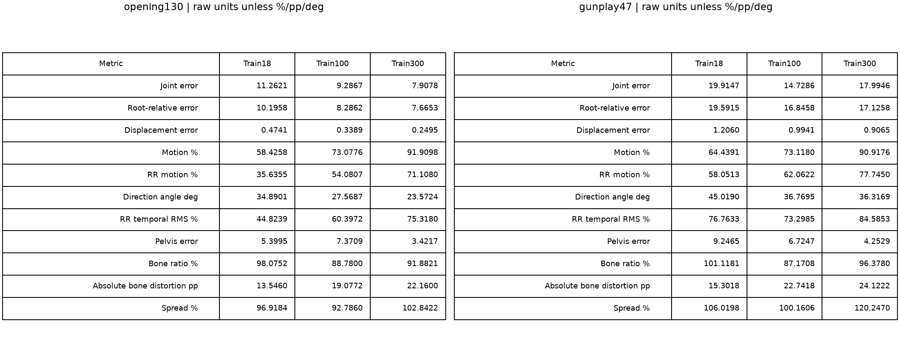
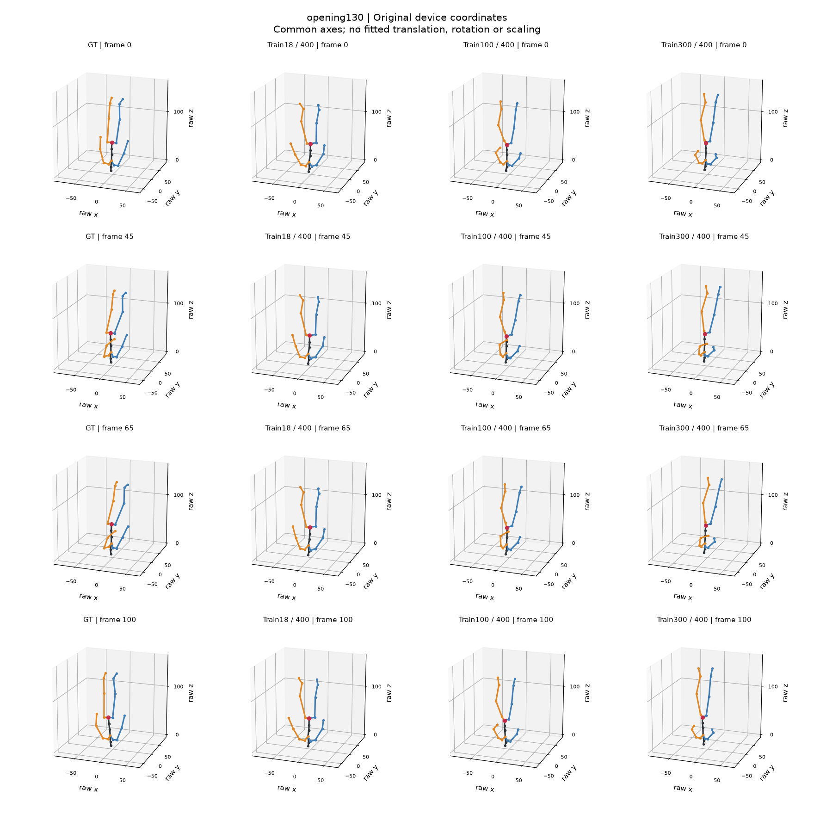
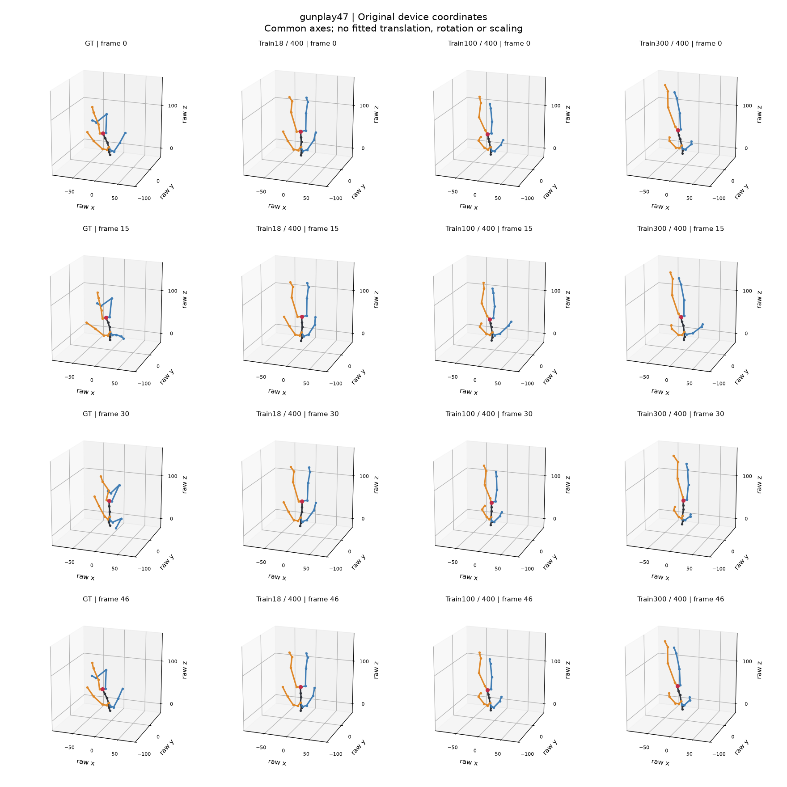

# M2 Dataset Scaling 300 — 실제 T4 결과

2026-11-17. **실제 T4 실행 PASS / Opening 품질 PARTIAL(7/8) / 추가 Validation 품질 PARTIAL(5/8) / 전체 파일 회수 PASS.**

Train300만 새 seed43 초기 상태에서400 updates 학습했다. Opening에서는 위치·움직임·골반 오차가 개선됐지만 개별 뼈 왜곡은 악화됐다. 새로운 Gunplay에서는 움직임과 골반 오차는 개선됐으나 위치 오차와 관절 퍼짐이 악화됐다. 데이터 확대가 모든 품질이나 일반화를 개선했다는 결론은 지지하지 않는다.

## 1. 학습 전에 고정한 데이터

| 용도 | 동작 | 인물 | Native frame | 수 |
|---|---|---|---|---:|
| 기존 Train | Brutal_Assassination | Adanna003 | 0–17 | 18 |
| 기존 Train | Standing_Up__1_ | Adanna003 | 0–49 | 50 |
| 기존 Train | Dodging | Carla001 | 0–31 | 32 |
| 신규 Train | Boxing__55_ | Carla001 | 0–49 | 50 |
| 신규 Train | Lifting__3_ | Janna002 | 50–99 | 50 |
| 신규 Train | Hip_Hop_Dancing__24_ | Joyce005 | 0–49 | 50 |
| 신규 Train | Pulling_A_Rope__9_ | Serena004 | 50–99 | 50 |
| Historical Holdout | Opening | 기존 sequence ID 유지 | 0–129 | 130 |
| 추가 Validation | Gunplay__9_ | Adanna003 | 0–46 | 47 |

Train 총300개이며 평가 프레임은 제외했다. 네 신규 시퀀스와 Gunplay는 학습·추론 전에 고정했다. 원본 Pose247개(약21.1MB)를 선택적으로 확보했고 RGB는 내려받지 않았다. 캐시 Manifest SHA는 기존100 실험과 같다.

[선택 Manifest](data_selection_manifest.json), [Train 목록](selected_frames.csv), [평가 목록](evaluation_frames.csv), [입력 검증](input_validation.json), [좌표 검사](coordinate_audit.csv)에 근거를 보존했다.

최초100개 Manifest 행, Sequence/Frame Key, Pose SHA와 모든 입력 배열이 기존 Train100과 일치한다. features/target_raw/valid/time의 dtype과 바이트도 동일하다. Train300 고유 key 및 Pose SHA는 각각300개다. 알려진 cache non-train split과 key/SHA 중복이 없고 Opening·Gunplay와 key 또는 정확히 같은 입력/GT pose 중복도 없었다. Body22·14차원/관절·유한값·Zero-camera·Window8·경계 reset·연속 native frame을 검사했다. World/camera/device 좌표 오차 최대는 약1.03e-13 raw다.

원본 mocap 독립성, FPS, mm 단위, 이번 RGB-2D 정합성은 **NOT VERIFIED**다. 기존 Train18 split은 역사적 할당을 유지했다. Gunplay는 캐시 Validation 근거가 있지만 공식 독립 Test로 부르지 않는다. 새 인물 Janna/Joyce/Serena가 추가되어 동작 다양성과 인물 구성 변화가 혼입된다.

## 2. 실제 실행 및 공정 비교

- 기준 결과 커밋: `d54e3f84acb42e029082bb8058b9c229ade75a83`
- 기존100 T4 소스: `6ccf0ab650a225ec0c823b9ff030ce19c5a7dc84`
- 이번 T4 소스: `ea762262507b79999b69b37ff9f421e9bc0be94e`
- Tesla T4 / Python3.13.16 / PyTorch2.14.1+cu130 / CUDA13.0 / FP32
- Body22, Hidden64, Graph1/Temporal2, Heads4, Window8, Dropout0
- Adam lr0.001, StepLR200 gamma0.5, batch8, seed43, 기존 Position Loss
- Diffusion1000, DDIM10, 평가 noise seed10043, GT Stereo2D, target100 raw, pixel1024
- 신규 Train300 한 군만 학습. Train18/100은 원본400 checkpoint 재사용.
- 모델·최적화·스케줄러·RNG 초기 해시와 diffusion noise trace가 기존 Train100과 일치.
- 핵심 모델 코드 및 기존 trainer SHA 일치. [공정 비교 검증](baseline_reuse_validation.json).
- Train300 체크포인트100/200/300/400 전부 회수. 최종400을 사전에 고정.
- 실제 학습 로그상400 updates 약18.67초. 전체 Colab 성공 셀 약51초이며 전송·사전 준비 시간은 별도다.
- 3,200 anchor draws,300개 모두 실제 추출됨. 평균 기대 노출10.67회/프레임(Train100은32회). 동일 update 예산 효과이며 동일 epoch 비교가 아니다.

로컬 CPU 회귀33개 PASS. Colab 최초 사전 검사는 설치된 tests 패키지와의 import 충돌로 실패했다. 학습 전 중단됐으며 실패 출력을 보존했다. unittest discover로 검사 진입점만 수정한 뒤 Colab15개 PASS와 실제400 학습·평가가 완료됐다. 모델·Loss·학습 소스는 변경하지 않았다. [노트북 근거](notebook_execution_validation.json), [Colab 검사](colab_regression_tests.log), [실제 console](console.log).

## 3. Opening130 — Historical Holdout

| 지표 | Train18/400 | Train100/400 | Train300/400 |
|---|---:|---:|---:|
| Global Joint Error (raw) | 11.2621 | 9.2867 | 7.9078 |
| Root-relative Error (raw) | 10.1958 | 8.2862 | 7.6653 |
| Frame Displacement Error (raw) | 0.4741 | 0.3389 | 0.2495 |
| Motion Ratio (%) | 58.4258 | 73.0776 | 91.9098 |
| Root-relative Motion (%) | 35.6355 | 54.0807 | 71.1080 |
| Direction Cosine | 0.7710 | 0.8260 | 0.8606 |
| Direction Angle (deg) | 34.8901 | 27.5687 | 23.5724 |
| RR Temporal Pose RMS (%) | 44.8239 | 60.3972 | 75.3180 |
| Pelvis Error (raw) | 5.3995 | 7.3709 | 3.4217 |
| Bone Length Ratio (%) | 98.0752 | 88.7800 | 91.8821 |
| Mean Absolute Bone Distortion (pp) | 13.5460 | 19.0772 | 22.1600 |
| Joint Spread Ratio (%) | 96.9184 | 92.7860 | 102.8422 |
| Arms RR Displacement Error (raw) | 0.4414 | 0.3581 | 0.3054 |
| Legs RR Displacement Error (raw) | 0.5571 | 0.3525 | 0.2315 |

Train100 대비 Joint Error **14.85%**, RR Error **7.49%**, Displacement Error **26.38%**, Pelvis Error **53.58%** 감소했다.

움직임 크기는73.08→91.91%, RR 움직임54.08→71.11%, RR 시간 변화 RMS60.40→75.32%로 개선됐다. 방향 각도27.57→23.57도, cosine0.8260→0.8606도 개선돼 크기만 증가한 것은 아니다. 평균 자세 쏠림은 완화됐지만 RR 움직임/RMS가100%에 미달하므로 해결됐다고 판단하지 않는다.

평균 뼈 길이 비율은88.78→91.88%로 개선됐지만 Mean Absolute Bone Distortion은19.0772→22.1600pp(**+3.0827pp**)로 악화됐다. 평균 비율은 서로 다른 연결의 축소·확대를 상쇄하므로 개별 형태 왜곡과 다르다. Joint Spread는92.79→102.84%로 약간 과대지만100%와의 거리는 줄었다.

개별 평균 비율 예: 왼쪽 lowerarm→hand46.84%, 왼쪽 calf→foot138.56%, spine02→spine03126.25%. 최악 프레임의 오른쪽 lowerarm→hand는41.21%였다. [연결별 전체 기록](bone_length_by_edge.csv), [사후 점검 목록](edge_screening.csv). 평균80/120% 또는 프레임50% 기준의 사후 표시는 사전8개 gate를 대체하지 않는다.

## 4. 새 Gunplay47 — 별도 Validation 동작

| 지표 | Train18/400 | Train100/400 | Train300/400 |
|---|---:|---:|---:|
| Global Joint Error (raw) | 19.9147 | 14.7286 | 17.9946 |
| Root-relative Error (raw) | 19.5915 | 16.8458 | 17.1258 |
| Frame Displacement Error (raw) | 1.2060 | 0.9941 | 0.9065 |
| Motion Ratio (%) | 64.4391 | 73.1180 | 90.9176 |
| Root-relative Motion (%) | 58.0513 | 62.0622 | 77.7450 |
| Direction Cosine | 0.6453 | 0.7199 | 0.7294 |
| Direction Angle (deg) | 45.0190 | 36.7695 | 36.3169 |
| RR Temporal Pose RMS (%) | 76.7633 | 73.2985 | 84.5853 |
| Pelvis Error (raw) | 9.2465 | 6.7247 | 4.2529 |
| Bone Length Ratio (%) | 101.1181 | 87.1708 | 96.3780 |
| Mean Absolute Bone Distortion (pp) | 15.3018 | 22.7418 | 24.1222 |
| Joint Spread Ratio (%) | 106.0198 | 100.1606 | 120.2470 |
| Arms RR Displacement Error (raw) | 1.7222 | 1.5138 | 1.4024 |
| Legs RR Displacement Error (raw) | 0.9878 | 0.8481 | 0.7030 |

Train100 대비 Joint Error **22.17% 증가**, RR Error **1.66% 증가**했다. Displacement Error는8.82%, Pelvis Error는36.76% 감소했다.

Motion73.12→90.92%, RR motion62.06→77.74%, RR RMS73.30→84.59%로 움직임 축소는 완화됐다. 방향 각도36.77→36.32도 개선은 작다. Spread100.16→120.25%로 과도하게 커졌다. Bone Distortion22.7418→24.1222pp(+1.3804pp)는2pp 제한 이내지만 절대 왜곡은 악화다. 왼쪽 lowerarm→hand 최소14.21%, clavicle→upperarm 최대205.62%가 관측됐다. 일반화 개선의 증거는 혼합적이며 공식 독립 Test 검증은 여전히 NOT VERIFIED다.

## 5. 사전 고정8개 기준

| 기준 (Train100 대비) | Opening130 | Gunplay47 별도 |
|---|---|---|
| Global Joint Error 감소 | PASS | FAIL |
| Root-relative Error 감소 | PASS | FAIL |
| Displacement Error 감소 | PASS | PASS |
| Motion Ratio가100%에 가까워짐 | PASS | PASS |
| RR Motion Ratio가100%에 가까워짐 | PASS | PASS |
| Pelvis Error 증가≤2% | PASS | PASS |
| Bone Distortion 증가≤2pp | **FAIL (+3.0827pp)** | PASS (+1.3804pp) |
| Spread의100% 거리 증가≤2pp | PASS | **FAIL (+20.0864pp)** |
| 종합 | **PARTIAL,7/8** | **PARTIAL,5/8** |

일부 주요 오차가 개선되면 PARTIAL이라는 사전 규칙을 그대로 적용했다. 실패 지표를 제외하거나 종료 checkpoint를 교체하지 않았다. 단일 seed 결과이며 통계적 유의성을 주장하지 않는다.

## 6. 원본 회수와 독립 검산

[독립 검산](result_validation.json) PASS. T4 원본 ZIP6,453,141bytes, SHA256 `b2aadfa73796da5292cf31f98c76497ffedbc714aef318824848e540a7ffaecc`. ZIP22개 엔트리 CRC 및21개 파일 SHA 확인. 네 checkpoint step/Optimizer/Scheduler/RNG와 전체400행 CSV/JSONL·random trace를 확인했다.

6개 Prediction NPZ의 저장 지표를 재계산했고 최대차이는0이었다. 별도 구현으로 주요10개 지표와 RR temporal RMS도 검산했다. 기존18/100의 Opening NPZ는 파일 바이트가 그대로다. 새 Gunplay의 세 모델 GT/mask/frame ID도 동일하다. 노트북의100/200/300/400 출력은 원본 JSONL 행과 일치하며 성공 종료코드는0이다. 검산은 추가 추론·학습을 수행하지 않았다.

Windows 소스 ZIP 생성 시 CRLF 변환이 발생한 것을 발견하여 원본 Git object를 LF로 다시 export했다. 최종 source_at_execution.zip의8개 실행 코드 SHA 및 config SHA가 T4 Identity와 모두 일치한다. 원본 학습 결과는 수정하지 않았다.

미회수 파일 없음. Pose 원본·NPZ·PT는 비공개 결과 ZIP에만 보존한다. GitHub에는 작은 기록·코드·그림만 게시한다. [회수 상태](recovery_status.json).

## 7. 실제 출력 시각화

- [Opening pelvis-relative](figures/opening130_root_relative.png), [Gunplay pelvis-relative](figures/gunplay47_root_relative.png)
- [Opening Displacement/Joint/Pelvis](figures/opening130_frame_comparison.png), [Gunplay](figures/gunplay47_frame_comparison.png)
- [Opening Bone](figures/opening130_bone_length.png), [Gunplay Bone](figures/gunplay47_bone_length.png)
- [Opening Spread](figures/opening130_joint_spread.png), [Gunplay Spread](figures/gunplay47_joint_spread.png)
- [실제400행 Loss](figures/training_loss.png)
- [Opening130 GIF](figures/opening130_comparison_motion.gif), [Gunplay47 GIF](figures/gunplay47_comparison_motion.gif)

실제 저장 배열만 사용했다. 기존 시점(elev18/azim-70)·축 방향·1:1:1 척도 규칙을 유지한다. 기존18/100 그림 범위 밖에 새300 출력이 있어 잘리지 않도록 공통 범위를 확장했다. 네 모델 패널과 모든 프레임에 같은 고정 범위를 적용했다. **과거 그림과 숫자상 축 한계가 완전히 같지는 않다.** 자동 정렬·회전·크기 보정은 없다. Pelvis-relative 그림은 각 skeleton의 pelvis만 뺀다. GIF 표시10fps는 원본 촬영 FPS를 의미하지 않는다. [시각화 검증](figures/visualization_validation.json)에 범위와 실제130/47 프레임을 기록했다.

## 8. 재현과 다음 단계

[실행 가능한 Colab notebook](REWIND_M2_Dataset_Scaling_300.ipynb)은 학습 소스커밋과 입력 ZIP SHA를 고정하며 제공된 `M2_scaling300_gpu_input.zip`을 업로드하도록 한다. 원본 학습은 완료됐으므로 단순 확인을 위해 재실행하지 않는다. 재검산 CLI는 README를 따른다. 준비·학습 코드는 소스커밋에, 독립 검산·시각화·보고서는 이후 결과 커밋에 구분해 보존한다.

500프레임 확대는 **보류 권고**다. Opening 개선으로 탐색 가치는 있으나 Bone gate 실패와 새 동작의 위치·Spread 악화가 있어 확대 효과가 안정적이라고 볼 수 없다. 현재400-update 예산에서는 프레임당 노출 감소도 함께 발생한다. 현재 결과를 먼저 분석하고 후속 실험의 평가 동작과 학습 예산을 별도로 사전 고정해야 한다. 이번에는500 학습·Loss 변경·구조 변경을 하지 않았다.
