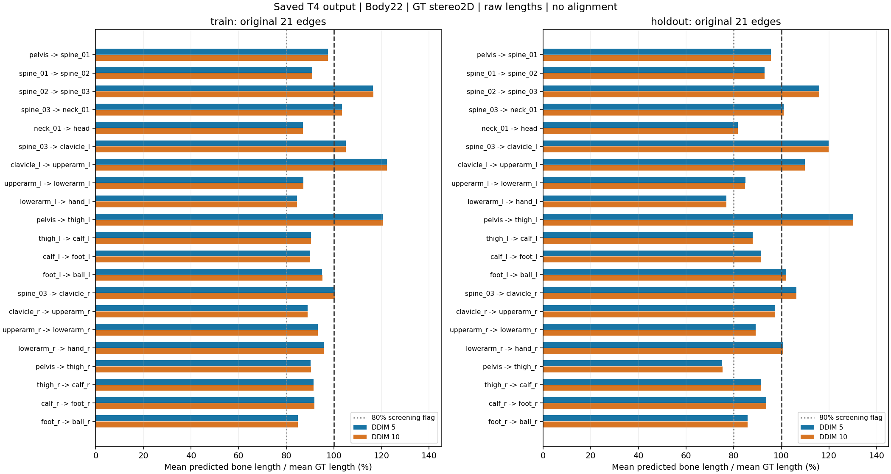
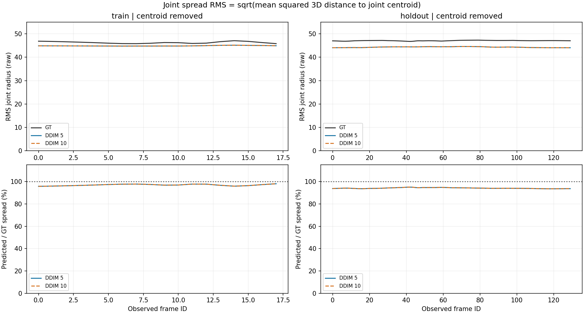
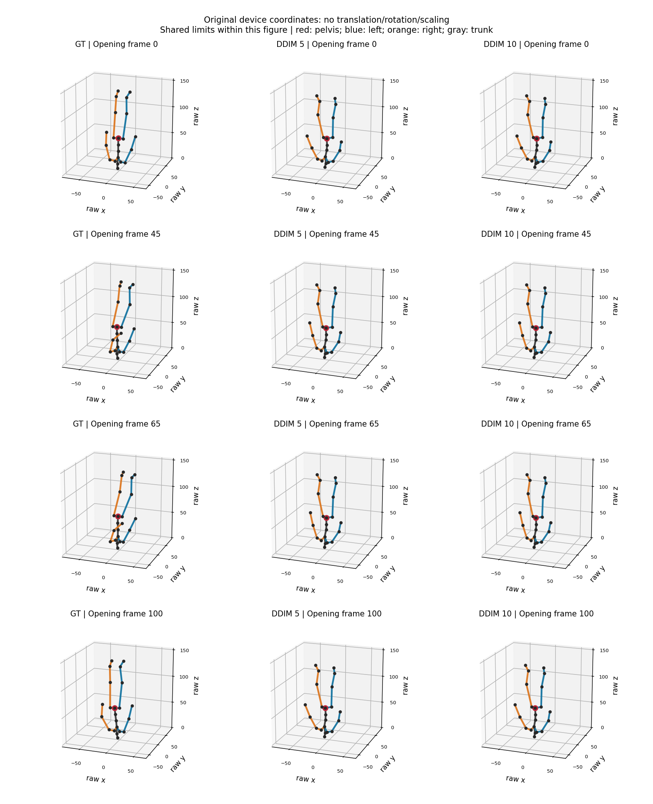
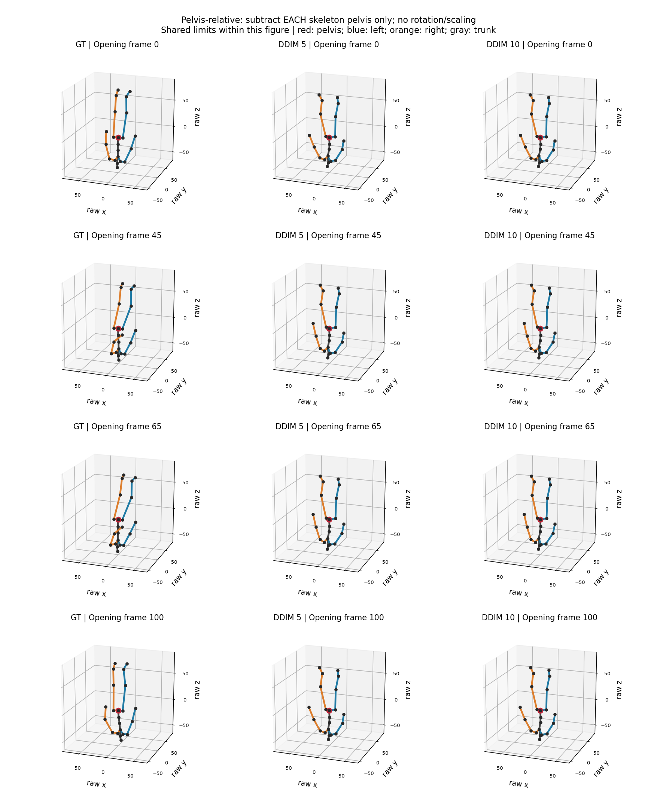

# M2 Skeleton Collapse 진단 — 2026-11-11

## 최종 판단

**전신이 한 점으로 뭉치는 심한 Skeleton Collapse는 이 M2에서 관측되지 않았다. E(복합 문제)이며, D(시간적 움직임 축소)가 우세하고 국소적인 뼈 길이·자세 왜곡과 C(위치 오차)가 동반된다.** D의 “형태 유지”는 전체 크기와 관절 분리가 유지된다는 의미이며, 올바른 자세를 복원했다는 뜻이 아니다.

Opening에서 평균 뼈 길이는 GT의 93.59~93.61%, 중심 제거 후 관절 퍼짐은 94.11~94.13%다. 반면 전체 움직임 크기는 40.31~40.56%, Pelvis 상대 관절 움직임은 26.13~27.18%뿐이다. Root-relative 자세 오차도 11.35 raw로 남아 전체 위치 이동만으로 해결되지 않는다.

다음 개선 실험으로 **Frame Displacement Loss 한 항 추가**를 선정한다. 이번 작업의 모델 로드·재추론·학습·optimizer update는 모두0회다.

## 1. 입력·재현 근거

- 사용자 Fork 기준: `b5d88b7368066d454c9e2b647cd7dd83508f0b19`, 브랜치 `experiment/final-m2-202611`.
- 읽은 실제 결과: `REWIND_M2_T4_final_results.zip` SHA256 `ebf6c18a053d53d5309a73a17ed146f1c4690e92ca89f09f0b69b54fc378c2f3`.
- ZIP CRC, 내부 SHA256SUMS, T4 GT·prediction·valid·frame_ids 네 NPZ, data_manifest/evaluation을 검증했다. 두 arm의 GT·mask·frame ID가 동일하다. 기존 Global JPE·Motion Ratio·Displacement Error를 다시 계산해1e-12 허용치 내 일치를 확인했다.
- 분석 입력은 저장된 T4 결과만이며 CPU·합성 예측·그림 추정 좌표를 섞지 않았다. 체크포인트는 읽거나 변경하지 않았다. 기록된 체크포인트 SHA는 `6acd1fd96a2dbfe1e681710a6286c3d9d0177ce69402a0b488f8fcce7a4a5c9d`다.
- Body22, manifest의21edges, pelvis index0. GT Stereo2D, zero-camera, window8, hidden64, graph1, temporal2, step300, FP32 조건.
- Train: Brutal_Assassination0–17,18프레임. Opening0–129,130프레임은 Historical Holdout이며 독립 test가 아니다. train/holdout 통합 평균은 보고하지 않는다.
- 모든 저장된22관절 mask가 유효하다. 프레임 사이 이동은 같은 시퀀스의 실제 연속 frame만 사용한다. 각 NPZ는 한 시퀀스이며 manifest와 기존 평가 계약을 따른다.
- 원래 단위는 raw device_pts3d. 물리 단위와 촬영FPS를 검증하지 않았으므로 raw, 프레임 사이 이동으로 표현한다. 우리 수치를 mm 또는 mm/s로 변환하지 않는다.

## 2. 지표 정의

### Bone Length Ratio

각 edge e=(a,b)의 길이를 `L(t,e)=||P(t,b)-P(t,a)||₂`로 계산한다. 양 끝 관절이 유효한 edge만 포함한다.

대표 전체 비율은 `100 × mean(Lpred) / mean(Lgt)`다. 이는 GT 뼈 길이에 따라 가중되는 pooled ratio다. 짧은 뼈를 같은 비중으로 보는 `100 × mean(Lpred/Lgt)`도 별도 열에 제공한다. Opening은 전자가 93.6%, 후자가 96.7%이므로 혼용하지 않는다. 각 뼈별 비율도 `mean_t(Lpred)/mean_t(Lgt)`이며 프레임별 최소·최대는 별도 CSV에 있다. GT 길이가 0인 edge가 있으면 비율을 임의로 채우지 않고 중단한다.

### Joint Spread RMS

매 프레임 유효 관절 평균 c를 제거하고 `S(t)=sqrt(mean_j(||P(t,j)-c(t)||₂²))`를 계산한다. GT와 예측은 각자의 관절 중심을 사용한다. 보고하는 GT/예측 spread는 프레임별 S의 산술평균, 비율은 그 평균끼리의 비율이다. 프레임별 비율 평균도 CSV에 따로 있다. x/y/z 전체 원소 RMS를 쓰는 정의보다 sqrt(3)배 크므로 절대 spread값을 다른 구현과 직접 비교하지 않는다. 같은 정의끼리 GT 대비 비율을 계산하면 이 상수는 소거된다.

### 위치·자세 오차

Global JPE는 원래 device좌표에서 관절별 Euclidean 오차 평균이다. Root-relative는 `Pj-Ppelvis`와 `Gj-Gpelvis`의 차이를 계산한다. 각자의 Pelvis를 제거하며, GT Pelvis를 예측에 입력하거나 회전·크기 정렬하지 않는다. 기본 22관절 평균에는 항상 0인 Pelvis가 포함된다. 따라서 나머지 21관절 평균도 제공한다. Pelvis Error는 원래 좌표의 두 Pelvis 사이 거리다. **이 세 오차는 스칼라로 더하거나 빼서 분해되는 값이 아니다.** Root-relative 오차에는 자세 방향·비율·관절별 위치 왜곡이 함께 포함되며 관절각만의 순수 오차도 아니다.

### Temporal Motion

기존지표는 `mean(||ΔP||)/mean(||ΔG||)`다. 추가로 각 프레임의 Pelvis를 제거한 21개 관절의 동일 비율을 계산해 전체 이동과 관절의 상대 움직임을 분리했다. 정답 이동 벡터와의 차이도 기존 지표대로 보존했다. Motion Ratio만 높고 벡터오차가 커지면 jitter나 잘못된 방향일 수 있으므로 개선으로 판정하지 않는다.

## 3. 전체 정량 결과

비율은%, 오차는 모두raw다.

| 구간 | DDIM | 뼈 길이 % | 관절 퍼짐 % | Global JPE | Root-relative22 | Pelvis 오차 | Motion % | Root-relative motion % |
|---|---|---|---|---|---|---|---|---|
| train | 5 | 93.8378 | 96.9286 | 7.5130 | 5.8665 | 5.4147 | 32.8321 | 30.6328 |
| train | 10 | 93.8568 | 96.9482 | 7.5131 | 5.8662 | 5.4108 | 32.8385 | 30.5937 |
| holdout | 5 | 93.5852 | 94.1125 | 12.2288 | 11.3513 | 3.6739 | 40.5589 | 27.1837 |
| holdout | 10 | 93.6054 | 94.1324 | 12.2320 | 11.3542 | 3.6759 | 40.3147 | 26.1274 |


절대 길이와 spread, 집계 정의 차이는 다음과 같다.

| 구간 | DDIM | GT 평균 뼈 길이 | 예측 평균 뼈 길이 | GT Spread RMS | 예측 Spread RMS | 개별 뼈 비율의 산술평균 % | Root-relative21 |
|---|---|---|---|---|---|---|---|
| train | 5 | 18.5279 | 17.3862 | 46.3211 | 44.8984 | 96.5446 | 6.1458 |
| train | 10 | 18.5279 | 17.3897 | 46.3211 | 44.9075 | 96.5615 | 6.1455 |
| holdout | 5 | 18.5279 | 17.3394 | 47.0997 | 44.3267 | 96.6784 | 11.8918 |
| holdout | 10 | 18.5279 | 17.3431 | 47.0997 | 44.3360 | 96.6994 | 11.8949 |


Train의 공간 퍼짐은 96.93~96.95%이지만 움직임은 32.83~32.84%다. 즉 holdout 일반화 문제 이전에 학습에 사용한 18프레임에서도 움직임 축소가 남는다. Opening의 root-relative motion은 26.13~27.18%로 더 작아 카메라/전신 이동만의 문제로 볼 수 없다.

## 4. 부위별 뼈 길이와 과도한 단축

| 연결선 | Train5 % | Train10 % | Opening5 % | Opening10 % |
|---|---:|---:|---:|---:|
| pelvis -> spine_01 | 97.57 | 97.53 | 95.72 | 95.69 |
| spine_01 -> spine_02 | 90.98 | 91.01 | 93.00 | 93.03 |
| spine_02 -> spine_03 | 116.48 | 116.50 | 115.94 | 115.98 |
| spine_03 -> neck_01 | 103.37 | 103.36 | 100.96 | 100.96 |
| neck_01 -> head | 87.08 | 87.11 | 81.77 | 81.80 |
| spine_03 -> clavicle_l | 105.07 | 105.03 | 119.86 | 119.84 |
| clavicle_l -> upperarm_l | 122.31 | 122.32 | 109.87 | 109.86 |
| upperarm_l -> lowerarm_l | 87.20 | 87.17 | 84.86 | 84.84 |
| lowerarm_l -> hand_l | 84.50 | 84.49 | 76.95 | 76.94 |
| pelvis -> thigh_l | 120.43 | 120.46 | 130.13 | 130.17 |
| thigh_l -> calf_l | 90.45 | 90.49 | 87.96 | 87.99 |
| calf_l -> foot_l | 89.99 | 90.05 | 91.56 | 91.59 |
| foot_l -> ball_l | 95.11 | 95.19 | 101.98 | 102.08 |
| spine_03 -> clavicle_r | 100.52 | 100.49 | 106.27 | 106.26 |
| clavicle_r -> upperarm_r | 88.89 | 88.91 | 97.36 | 97.37 |
| upperarm_r -> lowerarm_r | 93.29 | 93.33 | 89.16 | 89.16 |
| lowerarm_r -> hand_r | 95.79 | 95.81 | 100.75 | 100.78 |
| pelvis -> thigh_r | 90.25 | 90.33 | 75.19 | 75.26 |
| thigh_r -> calf_r | 91.43 | 91.45 | 91.59 | 91.61 |
| calf_r -> foot_r | 91.88 | 91.88 | 93.59 | 93.60 |
| foot_r -> ball_r | 84.84 | 84.87 | 85.79 | 85.85 |


Opening 10-step에서 **pelvis→thigh_r 75.26%, lowerarm_l→hand_l 76.94%**, neck→head 81.80%, upperarm_l→lowerarm_l 84.84%다. 앞의 두 연결선은 GT 대비 약 25%와 23% 짧다. 반대로 pelvis→thigh_l은 130.17%로 길어져 좌우 비율 왜곡이 존재한다. pelvis→thigh 연결은 이 skeleton의 고관절 offset 연결선이며 대퇴골 자체 길이로 부르면 안 된다. 대퇴부의 실제 연결은 thigh→calf다.

그래프의 80%선은 **사후 진단용 선별선**이며 생체역학적 정상/질병 기준이나 학습된 판정기가 아니다. Train 10-step의 뼈별 평균은 84.49~122.32%, Opening은 75.26~130.17%다. Opening 전체 프레임·edge 중 최소 비율도 약 70.65%로, 모든 관절이 같은 점으로 수렴하는 붕괴와는 다르다. 일부 짧아짐과 일부 늘어남이 전체 평균에서 상쇄되므로 평균만으로 정상 체형이라고 판단하지 않는다.



## 5. 관절 퍼짐과 실제 시각화

Opening 10-step의 프레임별 Spread 비율 범위는 93.54~95.03%, Train은 95.74~98.06%다. 특정 평균값만 정상이고 일부 프레임이 한 점으로 붕괴한 것도 이 자료에서는 관측되지 않는다.



아래 네 프레임은 요청한 0, 45, 65, 100이다. GT·5-step·10-step 세 그림에 같은 좌표 범위, 같은 x/y/z 축척, 같은 시점을 사용한다. 원래 그림에서는 좌표 이동·회전·확대·자동 정렬을 하지 않았다. Root-relative 그림은 각 스켈레톤의 Pelvis만 뺐으며 이를 제목에 명시했다. raw 좌표의 위쪽을 중력 방향으로 검증하지 않았으므로 화면상 인체 방향은 성능 판정에 쓰지 않는다.

| Opening frame | DDIM | Spread % | Bone % | Global JPE | Root-relative22 | Pelvis 오차 |
|---|---:|---:|---:|---:|---:|---:|
| 0 | 5 | 93.7313 | 92.8070 | 10.0280 | 8.7455 | 2.8988 |
| 0 | 10 | 93.7649 | 92.8315 | 10.0288 | 8.7476 | 2.8808 |
| 45 | 5 | 94.6482 | 93.9501 | 13.4862 | 12.7952 | 2.9855 |
| 45 | 10 | 94.6798 | 93.9771 | 13.4876 | 12.7998 | 2.9957 |
| 65 | 5 | 94.4507 | 94.2099 | 14.9162 | 13.7033 | 4.9706 |
| 65 | 10 | 94.4828 | 94.2377 | 14.9212 | 13.7067 | 4.9813 |
| 100 | 5 | 93.9344 | 93.3296 | 9.2940 | 9.8115 | 2.2440 |
| 100 | 10 | 93.9696 | 93.3648 | 9.2937 | 9.8118 | 2.2237 |


45·65프레임에서는 GT의 팔 배치가 변하지만 예측은 변화가 작고, Pelvis를 제거해도 차이가 남는다. frame65의 10-step은 Global 14.92, Root-relative 13.71 raw다. frame100은 Root-relative 9.81이 Global 9.29보다 조금 크다. Pelvis 오차와 다른 관절 오차 방향이 일부 상쇄될 수 있으므로 root 제거가 항상 평균 오차를 낮추는 것은 아니다.





## 6. A~E 판정과 DDIM 차이

| 후보 | 판정 | 근거 |
|---|---|---|
| A: 뼈 길이의 심각한 전신 축소 | 주된 문제 아님. 국소 단축은 존재 | 전체 93.6%, 최단 부위 평균 75.3%, 반대쪽 일부 130.2% |
| B: 관절이 중심으로 뭉침 | 이 저장 표본에서는 강하게 지지되지 않음 | 중심 제거 Spread 94.1%, 프레임 최소도 93.5% |
| C: 전체 위치 부정확 | 동반되나 Opening의 주원인으로 보기 어려움 | Pelvis 3.67 raw, root 제거 후에도 11.35 raw |
| D: 형태 규모가 남지만 움직임 축소 | 가장 뚜렷함 | Motion 40.3~40.6%, root-relative 26.1~27.2%; train도 32.8% |
| E: 복합 문제 | 최종 판정 | D 우세 + 국소 길이·자세 왜곡 + 위치 오차 |

10-step은 Opening 전체 뼈 비율이 5-step보다 0.0202 percentage point, spread가 0.0199 point 높을 뿐이다. 뼈별 비율 차이의 최대도 약 0.103 point다. 반대로 Root-relative 오차는 5-step 11.3513, 10-step 11.3542로 5-step이 아주 조금 낮다. 단일 checkpoint·noise 조건이므로 어느 쪽이 형태 복원에 유의하게 우수하다고 판정할 근거가 없다. 기존 속도 결과와 함께 보면 step 증가를 형태 붕괴 해결책으로 선정할 이유가 부족하다.

## 7. 가장 가능성 높은 원인과 확정할 수 없는 것

**우선 가설은 제한된 단일 motion의 18프레임과 위치 중심 학습에서 동적 관절 변화를 충분히 학습하지 못해, 형태 크기는 유지하면서 동작을 작게 출력하는 현상이다.** 저장 출력·학습 규모·손실 코드를 종합한 가설이며 인과 원인 확정은 아니다.

- 관측: train과 holdout 모두 움직임이 축소된다. 형태 퍼짐은 유지되며 sampling 5/10 변경 효과는 미미하다.
- 코드 확인: 기존 `rewind_m2/training.py:position_losses`의 `frame_loss`는 중간 프레임 예측 head의 **위치 MSE**다. 시간 차분 손실이 아니다. 마지막 x0 손실과 보조 위치 손실만 있고 정답 이동 벡터를 직접 맞추는 항이 없다.
- 미확정: GT 2D 조건을 얼마나 이용하는지, 최적화 수렴 부족과 데이터 다양성 중 무엇이 주원인인지, 별도 정규화·카메라 설계 영향은 확인되지 않았다. 저장 출력만으로 조건 반응 ablation을 수행했다고 주장하지 않는다.
- 낮은 우선순위: 전신 크기를 복원하는 Bone Length Loss나 Root-relative Pose Loss를 먼저 추가할 필요성은 이번 전신 축소 지표에서 강하지 않다. 두 손실이 불필요하다는 뜻은 아니며 이번에는 변수 하나만 선정한다.

## 8. 동료 M1~M3와의 비교 범위

동료 원본은 읽기 전용으로 조회했다. 확인 revision은 `e94c64d8689adc6186979b56906e1008b53fb76c`다.

- [V1 붕괴 진단](https://github.com/BattleMarine/REWIND-like-prototype/blob/e94c64d8689adc6186979b56906e1008b53fb76c/docs/V1_COLLAPSE_DIAGNOSIS.md)
- [V1.1 확대 기록](https://github.com/BattleMarine/REWIND-like-prototype/blob/e94c64d8689adc6186979b56906e1008b53fb76c/docs/V11_EPOCH_EXPANSION_RESULTS.md)

| 대상 | 입력·증거 | 공간적 형태 판단 |
|---|---|---|
| 이번 M2 | GT Stereo 2D, Body22, raw, Train18/Opening130, 저장 배열 직접 재계산 | 전신 크기는 대체로 유지, 움직임 축소·국소 왜곡 |
| 동료 V1 M1~M3 | RGB frontend → 예측 2D·camera → body/hand, 두 로컬 프레임의 저장 모델 진단 기록 | 2D heatmap 중앙 집중과 3D 뼈·spread의 극단적 축소 기록. Body의 GT 대비 뼈 길이가 약 1.7% 수준 |
| 동료 V1.1 | 10 epoch 출력 로그; checkpoint 미회수로 원배열 검증 불가 | Body 평균 뼈 비율 약 10.1%, spread 약 12.8%라는 로그 근거. 현재 M2에서 같은 붕괴를 확인한 것은 아님 |

동료 전체 규격은 62관절이지만 최신 spec의 **body22 이름과 순서는 우리 manifest와 일치**함을 확인했다. 그럼에도 전체 평가 관절 범위·입력·camera·데이터 split·학습량·모델 규모·단위·spread 정의가 달라 절대 오차를 직접 비교하지 않는다. 위 비율은 각 문서의 자체 GT 대비 값을 반올림한 설명이며 동일 benchmark 우열표가 아니다. 동료 M1의 중앙 집중 원인을 GT 2D를 직접 받는 우리 M2에 그대로 적용하지 않는다. V1.1의 로그값을 이번에 실측한 값으로 분류하지 않는다.

## 9. 단 하나의 후속 개선 실험: Frame Displacement Loss 추가

목적은 기존 인체 크기를 보존하면서 연속 관절의 이동 방향과 크기를 더 충실히 복원하는지 검증하는 것이다. 뼈 길이 손실·Root-relative 손실·새 데이터·모델 규모·sampler를 동시에 바꾸지 않는다.

제안 손실:

`L_new = L_existing + λ × mean_valid(||((P_t-P_(t-1))-(G_t-G_(t-1))) / s_delta||₂²)`

- P는 denoiser x0 출력을 기존 방식으로 raw 복원한 값이며 loss 계산 시에만 정규화한다. s_delta는 **Train18의 정답 관절 이동 벡터 RMS = 4.1444875 raw**로 고정한다. Holdout으로 정규화값을 정하지 않는다. 새 모델 출력을 확대하는 후처리가 아니다.
- λ는 0.1을 사전 제안값으로 고정한다. 검증된 최적값이 아니며 이번 한 번의 pilot에서 lambda sweep은 하지 않는다. s_delta와 λ는 새 항 정의의 일부다. 실제 gradient와 loss 비율을 기록하고 발산하면 중단하며 즉석 튜닝하지 않는다.
- 같은 sequence의 실제 연속 frame, 양 끝 joint/time mask가 모두 유효한 쌍만 쓴다. padding·sequence 경계·gap을 제외한다. 같은 8-frame window 내 인접 x0 출력의 차분을 학습하고 평가는 기존 streaming anchor 출력으로 한다. 두 경로의 차이가 남으므로 training loss 하락만으로 성공 판정하지 않는다.
- 이것은 `||ΔP||`를 작게 만드는 평활화 손실이 아니다. 정답 ΔG와의 벡터 차이를 줄이므로 기존 움직임 축소를 더 강제하는 방향으로 정의하지 않는다. FPS 미검증이므로 velocity라는 이름을 쓰더라도 물리 속도로 해석하지 않는다.

### 최소 공정 비교

기존 300-update checkpoint를 그대로 동결 보존한다. 후속 실행이 승인된 경우에만 같은 가중치에서 두 복사본을 만들어 각 100 update 추가한다. 총 추가 200 update이며 아키텍처·입력·Train18·batch8·precision·optimizer 설정은 동일하다.

| 비교 대상 | 추가 학습 | 바꾸는 것 |
|---|---:|---|
| 기존 Baseline | 0 | 보존된 step300 결과 |
| 동일 학습량 대조군 | 100 updates | 기존 loss 유지 |
| 개선군 | 100 updates | displacement 항만 추가(λ 0.1) |

대조군을 두지 않고 개선군만 300→400 update로 비교하면 loss 효과와 추가 학습 효과가 혼합된다. 두 군은 같은 초기 optimizer/scheduler 상태·batch 순서·diffusion timestep/noise를 사용한다. 새로운 실험 identity에 부모 checkpoint와 손실 설정 hash를 기록하며 기존 resume의 source/config guard를 무시해 이어붙이지 않는다. 기존 train_ready=false를 일반 학습 승인으로 바꾸지 않고, 검증된 GT 2D raw 진단 계약을 유지한다.

평가는 10-step과 같은 noise seed 10043으로 고정한다. 학습 중 checkpoint 선택이나 holdout 기반 튜닝을 하지 않고 미리 정한 100 update 종료본을 평가한다. Holdout은 이미 살펴본 자료이므로 후속 결과도 탐색적 진단이며 독립 일반화 검증이 아니다.

사전 성공 기준(제안): 대조군과 기존 Baseline 모두에 비해 Opening Displacement Error가 10% 이상 감소하고, Motion Ratio가 100% 쪽으로 가까워지며, Global/Root-relative 오차가 2% 넘게 악화되지 않아야 한다. 뼈 길이·spread 비율 및 45/65프레임 형태도 함께 확인한다. Ratio 상승만 있거나 손실만 줄면 개선으로 보고하지 않는다. 기준은 실용적인 pilot 판단 기준이며 통계적 유의성 기준은 아니다.

### 11월 15~18일 실행 제안

- 11월 15일: loss·mask·단위 검사와 두 군의 동일 초기 상태 확인. 실행 코드를 준비하되 기존 결과를 보존한다.
- 11월 16~17일: 한 차례 T4 pilot로 두 군 각 100 updates 및 동일 조건 평가. 이번 작업에서는 미실행이다.
- 11월 18일: 성공/실패 관계없이 수치·그림 회수와 원인 해석 확정. 데이터나 모델을 뒤늦게 확대하지 않는다.
- 11월 20일: 개발 동결, 11월 23일 발표. 시간 부족이나 checkpoint 문제로 진행 불가하면 현재 실측 진단을 최종 결과로 보존한다.

## 10. 산출물·검증 상태

- `skeleton_diagnosis.csv`: train/holdout·5/10별 요약 4행.
- `bone_length_by_edge.csv`: 21 edges × 4조건 = 84행. 모든 뼈별 평균/최소/최대.
- `frame_diagnosis.csv`: (18+130) × 2 = 296행. 프레임별 spread·bone·위치 오차.
- 요청한 PNG 4종: `bone_length_comparison.png`, `joint_spread_comparison.png`, `root_relative_comparison.png`, `skeleton_visualization.png`.
- `diagnose.py`: hash 고정 ZIP에서 직접 재계산·시각화. NumPy/Matplotlib만 사용하며 모델 라이브러리를 로드하지 않는다.
- `test_diagnose.py`: 평행이동 불변성, 0.5 축척, 형태 유지/시간 동작 0 분리, invalid-mask/gap 검사 4개. 합성값은 지표 검사에만 사용하며 결과표·그림에 포함하지 않는다.
- `evidence.json`: 원본 hash·관절·edge·축 범위·재계산 검증 근거.

지표 검사 4개와 저장된 실제 지표 재계산은 PASS다. 실제 PNG의 라벨·축척·연결선을 시각 검수했다. 원본 결과·checkpoint 변경 0, 재추론 0, 학습 0, 전체 데이터 다운로드 0. 후속 손실의 개선 효과는 NOT VERIFIED다.

재실행(모델 실행이 아닌 저장 배열 분석):

```bash
python experiments/final_m2/diagnosis_20261111/diagnose.py --bundle /path/to/REWIND_M2_T4_final_results.zip --output /path/to/new_diagnosis_directory
python -m unittest discover -s experiments/final_m2/diagnosis_20261111 -p 'test_diagnose.py' -v
```

결과가 이미 있는 경로는 덮어쓰지 않는다. 상세 계산은 새 진단 경로에만 보존한다.
