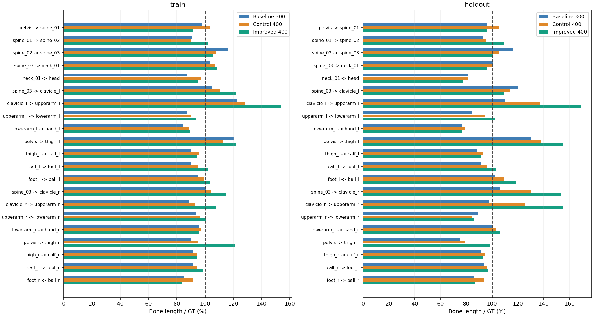
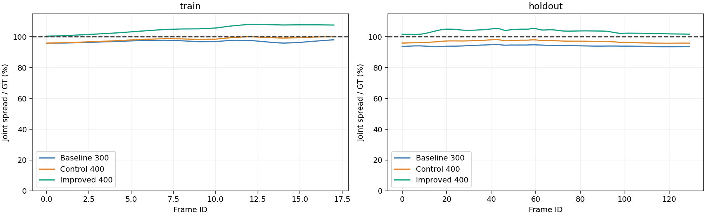
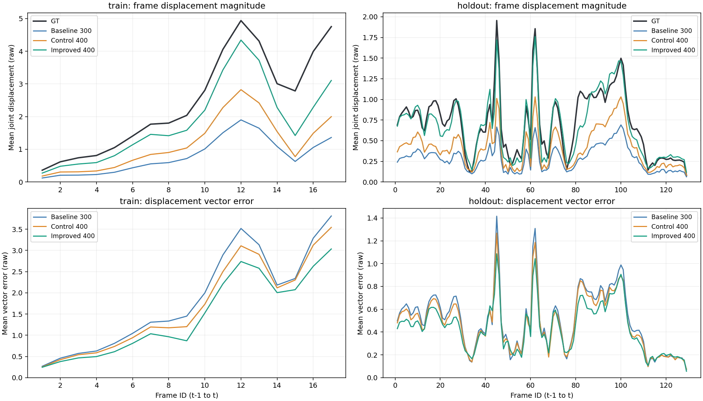
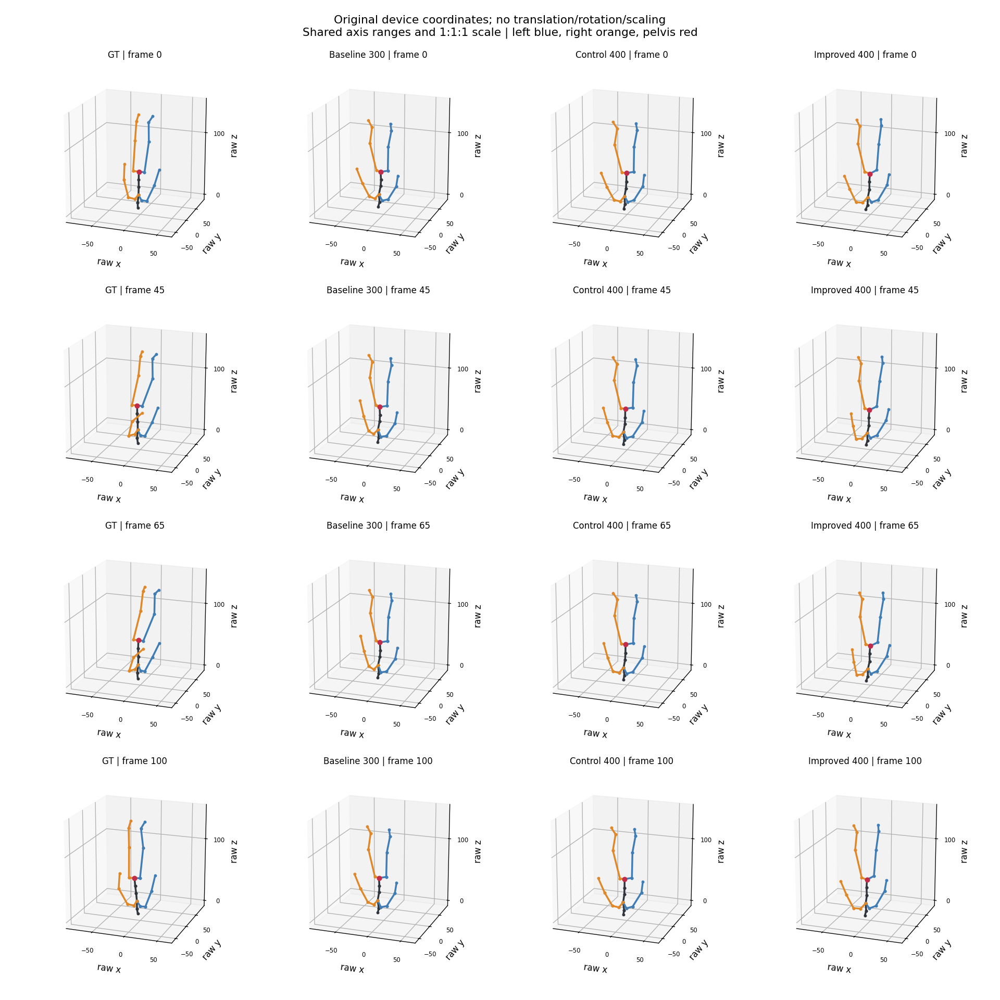
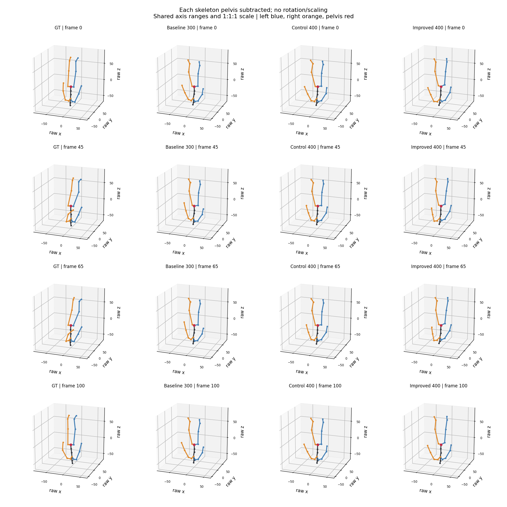

# M2 Frame Displacement Loss — 실제 T4 통제 실험

2026-11-16 (KST; 실행 UTC 날짜 2026-11-15). 사용자 Fork의 격리 브랜치 `experiment/m2-displacement-loss-20261116`.

## 결론

**실제 T4 실행·공정 비교·자료 검증은 PASS다. Improved400의 평균 움직임 복원은 세 모델 중 가장 좋지만, 사전 정의한 Pilot 성공 기준은 FAIL이다. 개선 효과는 PARTIAL로 해석한다.**

Opening130에서 Improved의 이동 벡터 오차는 **0.437863 raw**다. Baseline 대비 **13.04%**, 같은 학습량의 Control 대비 **7.65%** 감소했다. Motion Ratio는 **40.31% → 58.43% → 94.52%**다. 다만 Control 대비 10% 감소 조건을 충족하지 못했고 Pelvis 위치 및 일부 뼈 비율은 악화됐다. 94.52%를 “동작 정확도 94.52%”로 부르지 않는다.

기존 Baseline300을 보존하고, Improved를 탐색적 개선 후보로 남긴다. 실패한 기준을 사후 완화하거나 lambda·학습량을 바꿔 재실험하지 않았다. 이번에 실제 데이터로 실행한 추가 학습은 Control100 + Improved100 = 총200 optimizer update다.

## 1. 출처·무결성과 보존

- 시작 진단 commit: `be8cd6d0934f20c2aebd22fe38a2f3adcae7960b`.
- 학습·평가 고정 코드 commit: `c5d09511ac1c7a88156440e861a4719f85b6510a`.
- 원본 Baseline300 SHA256: `6acd1fd96a2dbfe1e681710a6286c3d9d0177ce69402a0b488f8fcce7a4a5c9d`.
- 고정148입력 ZIP SHA256: `184967a9732702fc0459350974b87e67f6499144dcfdbec48b18cb657805d74d`.
- 원래 T4 결과 ZIP SHA256: `ebf6c18a053d53d5309a73a17ed146f1c4690e92ca89f09f0b69b54fc378c2f3`.
- 원래 진단 ZIP SHA256: `ad43cc0a208f845800ec4c6f433ada05bbf640a724dbc7a3252af3284bcd20f1`.
- 실제 회수 ZIP SHA256: `50e78ec13e3045c37926d126eb28f6c444407af8ed4408e06ccadad3d19c3bbf`, 3,333,223bytes. CRC·내부22파일 checksum 검증 PASS.

원본 `main`, 동료 원본, 과거 M2 실험 브랜치, 원본 checkpoint와 이전 T4·진단 결과는 수정하지 않았다. 전체 UnrealEgo2 및 업로드 중인 Drive 자료에 접근하지 않았다. 신규 Colab 노트만 생성했고 원본 입력 보존본과 Git의 기존 checkpoint를 SHA 검사 후 사용했다. PR·merge·force push는 하지 않았다.

초기 Colab T4 할당이 지연돼 재연결했다. **학습은 한 번만 실행했다.** 완료 후 다운로드 연결 문제가 있어 이미 생성된 ZIP의 데이터를 회수하고 SHA를 검증했다. 이 회수 과정에서 모델을 재학습·재추론하지 않았다. 최종 PNG/GIF는 회수한 실제 NPZ를 로컬에서 그렸다.

## 2. 실험 설계와 통제

| 항목 | 고정 조건 |
|---|---|
| 데이터 | Train18: Brutal_Assassination0–17; Historical Holdout: Opening0–129 |
| 입력 | GT Stereo2D /1024, zero-camera, 기존 Body22·21edges·관절순서 |
| 좌표 | 저장된 device_pts3d raw; target 학습 정규화 /100, 출력 ×100 |
| 모델 | hidden64, heads4, graph1, temporal2, window8 causal, dropout0 |
| 학습 | FP32, batch8, 기존 Adam·StepLR 복원, 두 군 각100 updates |
| LR | step301–400 모두0.0005; step400 종료 후 scheduler LR0.00025 |
| Diffusion | 기존1000-step schedule·alpha_bar 및 코어4파일 SHA 동일 |
| 평가 | streaming AnchorSampler, DDIM10, frame-keyed noise seed10043 |
| 모델 선택 | 사전 지정 종료 step400만 평가; holdout 중간 평가·best 선택 없음 |
| GPU | Tesla T4, Python3.13.16, PyTorch2.14.1+cu130, CUDA13.0, CPU thread1 |

기존 checkpoint의 모델, Adam moment·step300, scheduler epoch300, scaler, Python/CPU/CUDA RNG가 완전했다. 두 군 초기 상태 각각의 SHA가 원본과 같고, 100개 update의 **배치 anchor·diffusion timestep·noise hash가 전부 동일**하다. 학습 종료 RNG hash도 동일하다. 실제 파라미터와 Adam의 step400 및 100행 학습 로그를 회수 후 재검사했다.

공통 학습 난수 trace SHA: `48336d80a7ff2743d94905bdfc2ac2644733f2b75ee731fac5e80aab8b4132ac`.

원래 checkpoint 생성 환경은 Python3.13.15 / PyTorch2.11.0+cu130이며 이번 환경과 다르다. 원래 프로세스를 bitwise로 그대로 이어간 것이라고 주장하지 않는다. **이번 두 군 사이의 초기 상태·환경·학습 입력 난수는 같음**을 검증했다. 기존 resume guard를 변경하거나 해제하지 않고, 고정 부모 SHA를 가진 별도 실험 identity로 분기했다.

| 모델 | Optimizer update | Checkpoint SHA256 |
|---|---:|---|
| Baseline | 300, 변경0 | `6acd1fd96a2dbfe1e681710a6286c3d9d0177ce69402a0b488f8fcce7a4a5c9d` |
| Control | 400, 추가100 | `1981b7ff9a5b7069629f5de2dc265014fcdd30d3d1744dea39b1d4aebeb02333` |
| Improved | 400, 추가100 | `e96c5fcb7d610714359d3e9cae1de0786bb4accc5719c465677c28236fe64fe3` |

학습 및 checkpoint 저장 구간 벽시계 시간은 Control 8.74초, Improved 7.51초다. 이는 환경 준비·평가·결과 회수 시간을 제외한 한 차례 관측으로, 두 loss의 속도 우열 근거가 아니다.

## 3. 손실 구현과 검증

`L_new = L_existing + 0.1 × mean_valid(sum_xyz((ΔP_raw − ΔG_raw) / 4.1444875)²)`

- P는 최종 x0 head 출력 ×100이다. 기존 `position_losses`와 보조 frame **위치** 손실은 그대로 사용했다.
- s_delta는 Train18 정답의 이동 벡터 RMS 4.144487503561436과 대조하고, 사용자 고정값4.1444875를 사용했다. xyz 제곱합을 joint-pair에 대해 평균하며 xyz 평균으로 1/3배 축소하지 않는다.
- 같은 sequence, frame 차이1, 양 끝 joint/time mask 유효 조건만 허용한다. 실제 저장 window의 모든 slot을 해당 실제 anchor의 데이터와 대조했다. train116·holdout1012 유효 slot 검증.
- Padding·frame gap·sequence 경계 제외, masked NaN 격리, 정확한 이동 벡터 loss0, 잘못된 벡터 양수, 실제 BodyDenoiser 파라미터 gradient, 미래 perturbation 차단을 검사했다.
- loss·gradient·parameter·Adam state NaN/Inf 시 중단한다. 이번에는 발생하지 않았다.
- 두 군 모두 기존 loss 및 displacement loss와 실제 파라미터 gradient norm을 기록했다. Control의 displacement 값은 관찰만 하고 가중치0으로 학습했다.

로컬 및 Colab 환경 각각 **새 검사9 + 기존 M2 회귀10 + 지표2 + 진단 지표4 =25개 PASS**. 테스트 합성 fixture는 이 보고서의 성능 표·예측 배열·그림에 포함되지 않는다. 추가 사후 검증은 재추론 없이 실제 배열의6행 지표를 1e-12 절대 허용치로 재계산해 모두 일치했다.

이번 Baseline300 재평가의 Train18·Opening130 예측은 **이전 T4 DDIM10 저장값과 bitwise 일치**한다. 더 오래된 원본 checkpoint 생성 때의 저장 예측과도 기존 허용치 안에서 재현됐다.

## 4. 정량 비교

오차는 모두 raw다. 물리 단위·촬영 FPS가 확인되지 않았으므로 mm, cm, mm/s로 표시하지 않는다. Bone Ratio는 `mean(pred length)/mean(GT length)`, spread는 각자의 관절 중심을 제거한 3D RMS 반경의 평균 비율이다. Root-relative22 오차에는 항상0인 pelvis가 포함된다. Root-relative motion은 pelvis를 뺀 나머지21관절의 연속 이동량 비율이다. CSV에 root-relative21 위치 오차와 뼈별 결과도 보존했다.

### Train18 — 학습 적합도

| 지표 | Baseline300 | Control400 | Improved400 |
|---|---:|---:|---:|
| Joint Error (raw) | 7.5131 | 6.3070 | 5.3446 |
| Frame Displacement Error (raw) | 1.8256 | 1.6697 | 1.4508 |
| Motion Ratio (%) | 32.8385 | 48.0848 | 75.3299 |
| Root-relative22 Error (raw) | 5.8662 | 4.7262 | 5.2827 |
| Root-relative21 Motion Ratio (%) | 30.5937 | 45.5720 | 70.6991 |
| Bone Length Ratio (%) | 93.8568 | 97.1251 | 100.3468 |
| Joint Spread Ratio (%) | 96.9482 | 98.3972 | 104.9109 |
| Pelvis Position Error (raw) | 5.4108 | 3.7947 | 2.4543 |

Train에서도 움직임은 크게 개선됐다. 다만 Improved의 root-relative22 오차5.2827은 Control4.7262보다 **11.78% 악화**했다. Global 위치 오차 감소와 모든 자세 오차 감소를 같은 뜻으로 해석하지 않는다.

### Opening130 — Historical Holdout

| 지표 | Baseline300 | Control400 | Improved400 |
|---|---:|---:|---:|
| Joint Error (raw) | 12.2320 | 11.2621 | 11.1410 |
| Frame Displacement Error (raw) | 0.5035 | 0.4741 | 0.4379 |
| Motion Ratio (%) | 40.3147 | 58.4258 | 94.5234 |
| Root-relative22 Error (raw) | 11.3542 | 10.1958 | 10.1676 |
| Root-relative21 Motion Ratio (%) | 26.1274 | 35.6355 | 58.6433 |
| Bone Length Ratio (%) | 93.6054 | 98.0752 | 101.5850 |
| Joint Spread Ratio (%) | 94.1324 | 96.9184 | 103.4993 |
| Pelvis Position Error (raw) | 3.6759 | 5.3995 | 6.5806 |

Control의 추가100 update만으로 Baseline 대비 이동 오차가 **5.83%**, Global 오차가 **7.93%**, root-relative 오차가 **10.20%** 감소했다. 기존 300 update에서 최적화가 끝나지 않았다는 설명과 부합한다.

그 위에 displacement 항을 추가한 Improved는 Control 대비 이동 오차 **7.65%**, Global 오차 **1.08%**, root-relative 오차 **0.28%**를 더 줄였다. Motion Ratio는 **36.10 percentage point**, root-relative motion은 **23.01 point** 높아졌다. 따라서 추가 학습만의 효과와 추가 loss의 효과를 분리할 수 있다. 단일 seed·단일 작은 train motion의 탐색 결과이며 통계적 유의성이나 독립 일반화를 입증하지 않는다.

### 사전 성공 기준

| 조건 | Baseline 대비 | Control 대비 | 판정 |
|---|---|---|---|
| Opening 이동 오차10% 이상 감소 | 13.04% 감소 | **7.65% 감소** | **FAIL** |
| Motion Ratio가100%에 가까워짐 | 40.31→94.52% | 58.43→94.52% | PASS |
| Global 오차2% 초과 악화 없음 | 8.92% 감소 | 1.08% 감소 | PASS |
| Root-relative 오차2% 초과 악화 없음 | 10.45% 감소 | 0.28% 감소 | PASS |
| 심한 스켈레톤 붕괴 없음 | 아래 형태 점검 | 아래 형태 점검 | PASS, 국소 왜곡 남음 |

**모든 조건을 동시에 만족해야 하므로 Pilot 최종 판정은 FAIL이다.** 양의 효과가 관측됐다는 해석은 PARTIAL이며 실패 조건을 바꾸는 것이 아니다.

## 5. 위치·형태의 부작용

Opening Improved의 전체 뼈 길이101.59%, spread103.50%로 전신이 한 점으로 뭉치는 collapse는 없다. 두 split 전체에서 Improved의 프레임별 spread 최소100.38%, 개별 프레임·edge의 최소 길이 비율72.38%다. 사전 실행 코드의50% 선별선은 보수적인 극단 축소 검사이지 정상 체형 기준이 아니다.

그러나 전체 평균이100% 근처라고 형태가 정확한 것은 아니다. Opening Improved의 뼈별 평균은 왼쪽 아래팔→손76.56%, 목→머리77.44%로 짧고, 왼쪽 clavicle→upperarm168.47%, pelvis→thigh_l154.91%로 길다. 일부 짧은 연결선과 긴 연결선이 평균에서 상쇄된다. pelvis→thigh는 고관절 offset 연결선이며 대퇴골 자체를 뜻하지 않는다.

특히 **Pelvis 위치 오차3.6759 →5.3995 →6.5806 raw**로 악화했다. Improved는 Control보다21.87%, Baseline보다79.02% 크다. 사전 성공 기준에 pelvis 개별 오차 제한이 없었더라도 이 부작용을 숨기지 않는다. 이동 벡터 loss는 일정한 위치 offset에 불변이므로 시간 변화 개선이 절대 위치 개선을 보증하지 않는다.

## 6. 프레임별 개선과 실패

표의 이동 오차는 frame(t−1)→frame(t)의 벡터 오차다. frame0은 이전 프레임이 없어 정의하지 않는다.

| Frame | 조건 | Global | Root-relative22 | Pelvis | 이동 벡터 오차 |
|---:|---|---:|---:|---:|---:|
| 0 | baseline | 10.0288 | 8.7476 | 2.8808 | — |
| 0 | control | 9.3708 | 8.4350 | 3.1055 | — |
| 0 | improved | 9.0507 | 8.2917 | 3.2821 | — |
| 45 | baseline | 13.4876 | 12.7998 | 2.9957 | 1.4160 |
| 45 | control | 12.0587 | 11.3034 | 5.8236 | 1.2674 |
| 45 | improved | 11.8034 | 11.4851 | 7.3930 | 1.0866 |
| 65 | baseline | 14.9212 | 13.7067 | 4.9813 | 0.3605 |
| 65 | control | 13.5118 | 12.0490 | 6.8904 | 0.3546 |
| 65 | improved | 13.1997 | 12.3344 | 9.1203 | 0.3515 |
| 100 | baseline | 9.2937 | 9.8118 | 2.2237 | 0.9885 |
| 100 | control | 8.7229 | 8.8263 | 5.3089 | 0.8918 |
| 100 | improved | 8.4029 | 8.5409 | 4.1756 | 0.9060 |

Opening의129개 실제 이동 구간 중 **97개는 Improved가 Control보다 이동 오차가 작고,32개는 크다.** 최대 개선은 frame45:1.2674→1.0866 raw(−0.1808); frame61도1.0568→0.8923이다. 최대 악화는 **frame43:0.4869→0.5873 raw(+0.1004)**이며 Baseline0.4645보다도 나쁘다. frame59·69·51·42에서도 악화가 관측됐다. 이는 사후 사례 분석이며 checkpoint 선택에 사용하지 않았다.

- **Frame45:** GT 이동량1.9546, Control1.0120, Improved1.7195로 큰 변화의 진폭이 가까워지고 벡터 오차도 감소했다. 그러나 root-relative 자세는 Control보다 약간 나쁘고 Pelvis 오차는5.8236→7.3930으로 커졌다.
- **Frame65:** 이동 오차0.3546→0.3515로 차이가 작다. Root-relative 오차12.0490→12.3344, Pelvis6.8904→9.1203으로 악화했다. 평균 성능을 모든 프레임의 개선으로 일반화하지 않는다.
- **Frame100:** GT 이동량1.4974에 대해 Improved1.4626으로 진폭은 가까워졌다. 그래도 벡터 오차는 Control0.8918보다 큰0.9060이다. 크기 일치가 방향·관절별 움직임 일치를 보증하지 않는 사례다.

## 7. 실제 3D 시각화

모든 패널은 실제 저장된 예측을 사용한다. 원래 device 좌표, 동일 x/y/z 범위와1:1:1축척, 같은 시점을 유지한다. GT에 맞춘 이동·회전·확대·Procrustes 정렬은 없다. 두 번째 그림만 각 스켈레톤 자신의 Pelvis를 뺀 별도 비교다. 좌표의 위쪽이 실제 중력 방향인지 검증되지 않아 표시된 방향을 교정하지 않았다.

개인 결과 패키지의 `figures/opening_motion.gif`는130프레임 전부를 같은 고정 축에서 비교한다. 표시 속도10FPS이며 촬영 FPS가 아니다. 그림과 이동량 곡선에서 Improved의 변화가 커진 점은 보이지만, 팔 배치·비율 및 위치 차이도 남는다. 시각적으로 “정상 복원”에 도달했다고 판정하지 않는다.

## 8. 원인 해석과 11월20일 마감 결정

**관측으로 지지되는 설명:** 추가 학습만으로도 시간 움직임이 늘고, 같은 학습량에서 이동 벡터를 직접 맞춘 loss가 추가 이득을 낸다. 따라서 300 update의 제한된 최적화와 위치 중심 objective가 기존 움직임 축소에 함께 관여했을 가능성이 높다.

**남는 가설:** 정규화된 displacement 항이 위치 항보다 강하게 작용하고, Train18의 좁은 동작 범위 및 학습 window 내부 x0 차분과 실제 streaming anchor 평가 간 차이 때문에 이득이 모든 관절·프레임으로 옮겨가지 않았을 수 있다. Improved의 가중 displacement gradient norm / 기존 gradient norm 중앙값은 **4.10배**, 최대21.86배다. 이는 로그 관측이며 원인 확정이나 lambda 재최적화 결과가 아니다. 다른 방향의 gradient 간 관계·data 다양성·조건 활용도는 이 실험 하나로 분리하지 않았다.

Train displacement loss의 처음10 update 평균→마지막10 평균은 Control0.9095→0.6363, Improved1.0300→0.2453이다. 학습 목표 개선은 확인되지만 이를 holdout 성공 판정으로 대체하지 않는다. 위치 offset에 둔감한 추가 항의 특성은 Pelvis 부작용과 일관되나, 이를 유일한 원인으로 단정하지 않는다.

**마감 권고:** 이번 통제 실험과 결과물을 동결하고 발표에는 “움직임 축소 완화, Control 대비7.65% 추가 감소, 사전10% 문턱 미달·Pelvis/국소 형태 부작용”을 함께 제시한다. 11월20일 전에 성공 판정을 얻기 위한 임의 lambda sweep·학습량 연장은 하지 않는다. Baseline300은 기준 모델로 유지하고 Improved400은 실험 후보로 구분한다. 전신 위치와 뼈 비율까지 안정된 최종 모델이라고 자동 승격하지 않는다. 향후 품질 개선에는 추가 검증이 필요하지만, 이번 목표인 한 차례 공정 비교를 완료하기 위한 추가 학습이나 구현 변경은 필요하지 않다.

## 9. 완료 상태와 산출물

| 항목 | 상태 | 근거 |
|---|---|---|
| 입력·기존 결과 SHA/CRC·checkpoint 상태 | PASS | preflight_validation.json, result_validation.json |
| 손실·mask·gradient·causal 회귀25개 | PASS | 로컬 로그와 metrics/t4/validation_tests.log |
| T4 두 군 실제100-update·동일 난수 | PASS | 두 training.jsonl, identity, random_trace |
| Baseline 포함 동일 조건 실제 평가 | PASS | 6 NPZ, comparison.csv; 이전 T4 baseline bitwise 일치 |
| 사전 Pilot 성공 조건 전부 만족 | **FAIL** | Control 대비 이동 오차 감소7.65%<10% |
| 관측된 품질 개선 | PARTIAL | 움직임 개선, Pelvis·국소 비율·일부 프레임 악화 |
| 실제 그림·130frame GIF | PASS | 저장 배열만 사용; labels·축·연결선과 GIF130frame 확인 |
| 독립 test·예측2D/RGB 입력 일반화 | NOT VERIFIED | GT2D·Historical Holdout 단일 pilot 범위 |

Git에는 코드·고정 설정·테스트/학습 로그·checkpoint SHA·정량CSV·PNG·보고서를 보존한다. 대용량 checkpoint, 실제 예측 NPZ, 원본 회수ZIP, 입력 및 실행 notebook,130frame GIF는 개인 전달ZIP에 포함한다. 원본에서 모델을 다시 실행할 필요 없이 저장 배열로 보고서를 재검사할 수 있다.

실행 진입점은 README.md 및 `REWIND_M2_Displacement_T4_private.ipynb`를 따른다. private notebook은 검증 입력을 포함하므로 공개 Git에 올리지 않는다. 학습된400-update 파일은 별도 experimental format이며 기존300 checkpoint 위에 덮어쓰지 않는다. 새로운 학습 재시도는 이 보고서 작성에 포함되지 않는다.
