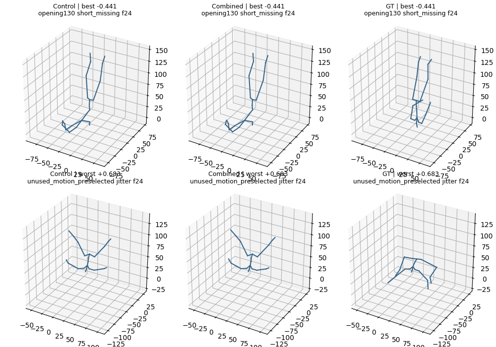
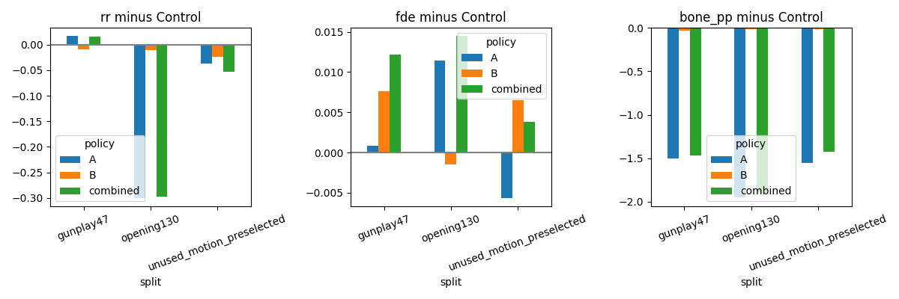

# Phase 4 · 지속 구조 오류와 순간 추적 오류

**사전 전체 판정 FAIL.** Global JPE와 clean fast 기준은 충족했다. FDE는 Control보다 악화됐고 비오염 프레임 보호 효과는 기준에 미달했다. 모든 평균은 세 기존 validation × 다섯 조건 동일 가중이다.

| policy   |     jpe |      rr |    fde |   bone_pp |   uncorrupted_active |   uncorrupted_harmful |   cpu_ms |
|:---------|--------:|--------:|-------:|----------:|---------------------:|----------------------:|---------:|
| A        | 15.4679 | 13.2526 | 2.3251 |   21.7279 |               0.9224 |                0.4155 |   0.1771 |
| B        | 15.497  | 13.3446 | 2.3271 |   23.3779 |               0.201  |                0.0835 |   0.1895 |
| combined | 15.4654 | 13.2477 | 2.333  |   21.8034 |               0.9224 |                0.4132 |   0.1916 |
| control  | 15.5064 | 13.3592 | 2.3229 |   23.4005 |               0      |                0      |          |
| phase2   | 15.5137 | 13.1055 | 2.267  |   18.3571 |               1      |                0.431  |   0.124  |
| phase3   | 15.4688 | 13.3096 | 2.3106 |   22.9077 |               0.3528 |                0.1631 |   0.5685 |

## 경로별 역할

A만으로 평균 RR JPE와 골격 왜곡이 줄었다. 길이 편향은 관측 누락과 독립적으로 지속될 수 있다. B는 누락 또는 양안 연결벡터의 인과적 잔차와 3D 혁신이 같이 나타날 때만 발동했다. B만으로는 수정 범위가 작고 FDE 개선을 얻지 못했다. 결합은 A보다 Global/RR JPE를 소폭 더 낮췄지만 FDE와 골격 왜곡은 더 컸다. A와 B가 각각 도움이 되는 상황이 있다는 것과 결합이 모든 목적에 이득이라는 것은 구분해야 한다.

Combined가 보존한 Phase 2 개선량은 RR 44.0%, FDE -18.2%, Bone 31.7%였다. 음수는 Control보다 악화된 경우다. Phase 3의 비오염 수정률·악화율 감소 중 보존한 비율은 각각 12.0%, 6.7%였다. clean fast 이동량의 100% 절대편차는 Control 16.20, Phase 2 15.45, Phase 3 16.10, Combined 15.36%p였다.

## 원인과 전파

전체 1170 frame-condition, 24570 edge-frame에서 A 후보 9588, B 후보 1281, 중복 539. 중복 중 238회는 반대 방향으로 충돌해 목표 보정을 0으로, 나머지는 B 우선으로 정했다. 변화량 상한 때문에 이전 offset은 즉시 사라지지 않을 수 있다.

Phase 3 점수 ≤1인데 실제 이전 offset의 절댓값이 1e-7 raw보다 큰 edge-frame은 435개였다. A 기준의 지속 편향 중 Phase 3 점수가 꺼진 경우는 8608개다. Opening clean은 A 후보 1,275개 전부가 여기에 해당한다. 이 수는 prior와의 지속 불일치이지 GT 기반 오류 정답이 아니다.

국소 offset이 적용된 edge-frame 10345개 가운데 해당 이동만 자손에서 제거해 대조했을 때 자손 평균 JPE가 줄어든 경우 6725, 악화된 경우 3620였다(1e-6 raw 이내 동률 제외). 가장 긴 연속 적용은 126프레임. 다른 연결의 이동은 고정한 사후 진단이다. 근위 연결 제한으로도 비오염 프레임 수정률이 높은 문제는 남았다.

## 동작 및 사례

|                                           |     jpe |      rr |    fde |   bone_pp |   uncorrupted_active |   uncorrupted_harmful |
|:------------------------------------------|--------:|--------:|-------:|----------:|---------------------:|----------------------:|
| ('gunplay47', 'A')                        | 19.5735 | 17.4204 | 1.9658 |   23.1361 |               0.8936 |                0.8936 |
| ('gunplay47', 'B')                        | 19.48   | 17.3945 | 1.9726 |   24.6074 |               0.1963 |                0.0956 |
| ('gunplay47', 'combined')                 | 19.5764 | 17.4194 | 1.9771 |   23.1724 |               0.8936 |                0.8936 |
| ('gunplay47', 'control')                  | 19.4831 | 17.4036 | 1.9649 |   24.6409 |               0      |                0      |
| ('gunplay47', 'phase2')                   | 19.4635 | 17.0669 | 1.9059 |   19.67   |               1      |                0.7555 |
| ('gunplay47', 'phase3')                   | 19.4343 | 17.3489 | 1.9478 |   24.1636 |               0.431  |                0.1619 |
| ('opening130', 'A')                       | 10.0627 |  8.69   | 1.3324 |   19.89   |               0.9615 |                0      |
| ('opening130', 'B')                       | 10.2877 |  8.9798 | 1.3195 |   21.8287 |               0.0429 |                0.0219 |
| ('opening130', 'combined')                | 10.0644 |  8.6923 | 1.3354 |   19.9464 |               0.9615 |                0.0049 |
| ('opening130', 'control')                 | 10.2976 |  8.9902 | 1.3209 |   21.8444 |               0      |                0      |
| ('opening130', 'phase2')                  | 10.0327 |  8.5437 | 1.3079 |   17.2057 |               1      |                0      |
| ('opening130', 'phase3')                  | 10.2412 |  8.9327 | 1.3099 |   21.5246 |               0.1187 |                0      |
| ('unused_motion_preselected', 'A')        | 16.7673 | 13.6474 | 3.6771 |   22.1576 |               0.9122 |                0.353  |
| ('unused_motion_preselected', 'B')        | 16.7232 | 13.6594 | 3.6892 |   23.6977 |               0.3638 |                0.1329 |
| ('unused_motion_preselected', 'combined') | 16.7554 | 13.6313 | 3.6866 |   22.2914 |               0.9122 |                0.341  |
| ('unused_motion_preselected', 'control')  | 16.7384 | 13.6838 | 3.6827 |   23.7162 |               0      |                0      |
| ('unused_motion_preselected', 'phase2')   | 17.045  | 13.7058 | 3.5872 |   18.1955 |               1      |                0.5375 |
| ('unused_motion_preselected', 'phase3')   | 16.7308 | 13.6473 | 3.6741 |   23.0349 |               0.5088 |                0.3274 |

| split                     | condition     |   frame |   local_edges |   moved_joints |   jpe_delta |
|:--------------------------|:--------------|--------:|--------------:|---------------:|------------:|
| opening130                | short_missing |      24 |            12 |             15 |   -0.441185 |
| unused_motion_preselected | jitter        |      24 |             9 |             12 |    0.683027 |

사례는 Combined−Control Global JPE 최소·최대 프레임으로 사후 선택했다. 각 행 안에서 세 스켈레톤은 동일 축 범위·시점을 사용한다.




## 범위 및 재현

원본 T4 ZIP SHA256 6d8e29d88a4e6b1735244b5f302ecf26159841b87d3c7c7a39871312a32d82ee 및 내부 파일 전체, 입력 NPZ 4개 SHA, GT·mask·frame ID·edge와 저장된 선택 출력을 대조했다. checkpoint SHA는 기존 T4 summary와 frozen_checksums 양쪽 기록으로 검증했다. 이번 측정은 저장 예측 CPU 후처리이며 checkpoint 재로딩·GPU 추론은 수행하지 않았다. cpu_ms는 Python/NumPy 단일 실행의 frame 평균이다.

입력 출처는 Phase 2 REPORT와 같다. 로컬 첨부 목록 및 기존 Drive 실험 폴더에서 확인한 데이터는 기존 INPUTS와 결과 패키지다. 새 출처·동작 중복·전처리·동결 모델 출력을 모두 검증할 수 있는 새 sequence는 확보하지 못했다. 기존 3개 동작에서 반복 관찰한 결과이며 새 인물·실제 RGB·실제 카메라 일반화는 미검증이다. 현 오프라인 동작 비교를 위한 추가 Work T4 실행은 필요하지 않다.

```bash
python -m experiments.final_m2.dual_phase4.evaluate --archive REWIND_M2_Selective_T4_20261121_VERIFIED.zip --inputs inputs --candidate candidate/joyful57.npz --out new_results
python -m unittest experiments.final_m2.dual_phase4.test_dual -v
```

결과물은 policies.csv(정확도·골격·이동 비율·CPU 시간), frames.csv(경로 중복·충돌 및 잔여 상태), edges.csv(연결별 자손 전파·이득·손해), verdict.json(사전 판정·동작별 평균)에 보존했다.
