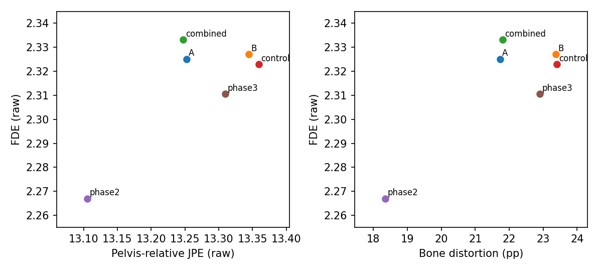
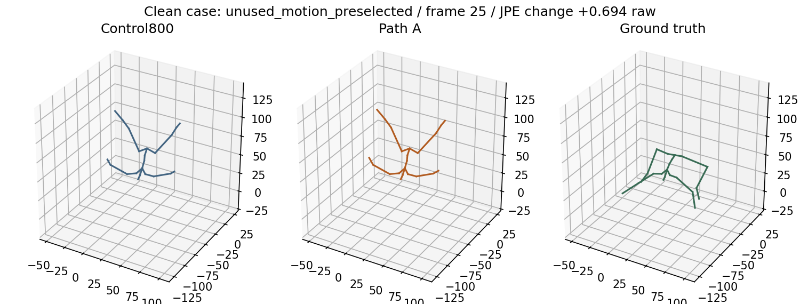
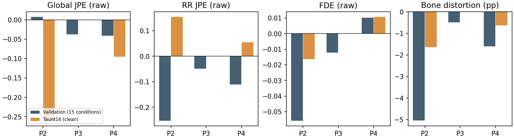
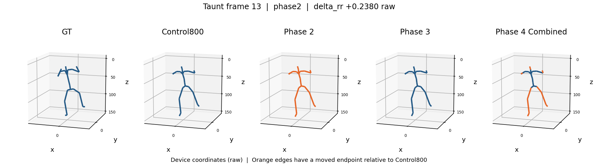

# REWIND M2 최종 기술 감사 | 2026-11-23 발표

**세 Validation에서 골격 일관성은 개선할 수 있었다. 그 보정이 특정 관절의 3D 위치와 다음 프레임의 움직임을 함께 개선할지는 지속 길이 편차만으로 판별하기 어려웠다.** Phase 4는 사전 종합 기준 FAIL이다. 추가 동작 Taunt16의 실제 T4 추론에서도 Phase 2·3·4는 사전 기준을 통과하지 못했다. 상위 원본 mocap 독립성은 미확인이다.

## 무엇을 통제했는가

원 연구는 2D uncertainty와 시간 문맥, 전신 추적 및 빠른 추론을 다룬다. M2는 Body22, GT Stereo2D, zero-camera, 인과 Window8, DDIM10으로 범위를 고정했다. 실험 질문은 관측–상태 불일치 및 연결 길이 편차로 보정할 위치와 시점을 결정할 수 있는가였다. GT valid는 가시성 추정치가 아니다. 단위는 raw, 시간은 프레임이다. 실제 RGB frontend, 물리 속도, 카메라 재투영, adaptive diffusion 연산 절감은 검증 범위 밖이다. [연구 방향 원문](https://github.com/darkkyoung/REWIND-like-prototype/blob/859b3c79c94512d9944500473fcabb4a1b5f1465/docs/RESEARCH_DIRECTION_20261104.md)

Train18→100→300 확대 실험에서 400 updates를 고정했다. Train300/400의 Opening JPE/RR/Bone은 7.908/7.665/22.160, Gunplay는 17.995/17.126/24.122였다. 원래 8개 검사 중 Opening 7개, Gunplay 5개로 PARTIAL이었다. 데이터 양과 동작·인물 구성이 함께 달라졌다. [Dataset Scaling 300](../dataset_scaling_300/M2_DATASET_SCALING_300.md)

Bone Loss는 같은 Train300/400 상태에서 400회 더 학습한 두 군을 비교했다. 기존 x0 위치 목적에 양 끝 joint와 time mask가 유효한 edge의 평균 제곱 길이 오차를 추가했다. GT raw를 100으로 나눠 x0와 단위를 맞췄다. 가중치는 train 8개 배치의 위치/골격 gradient norm 비 중앙값 × 0.1로 사전 고정했다. 깨끗한 Opening/Gunplay/Joyful에서 Control→Improved 골격 왜곡은 각각 18.994→13.463, 22.323→17.136, 21.276→15.519 pp였으나 RR JPE는 6.776→6.897, 15.440→16.066, 11.835→12.406으로 모두 악화했다. 전체 기준 FAIL. GT 길이는 학습 목적에만 사용했고 추론 중 자손 투영은 없다. [손실](../bone_length_loss_20261117/loss.py) · [분기 및 대조 조건](../bone_length_loss_20261117/config.json)

## 프레임 선택에서 연결 보정까지

|단계와 가설|prior · 게이트|보정량 · 전파 · 시간 처리|기존 판정 및 근거|
|---|---|---|---|
|1. 관측 실패를 검출하면 더 좋은 teacher를 선택할 수 있다|Train 분포로 정규화한 관측 잔차, 매 프레임의 상태 innovation·길이 급변·누락. 선택 점수 P95|두 teacher 전신 자세 중 하나 선택. 국소 offset·전환 완화 없음|RQ1/RQ2 FAIL. 누락 123/123, jitter 2/63 선택. clean fast 오탐 Gunplay 4/12, Joyful 9/14. 15조건 중 양쪽보다 JPE 또는 FDE가 낮은 조건 각각 0개|
|2. Control의 방향을 유지하며 길이를 교정할 수 있다|Train300 edge 중앙값. 5% 이내 no-op, 누락·2D innovation이 gain을 0.35→0.8로 높임|초과 편차에 gain 적용, 상한 0.12L. 현재 목표 75%+이전 scalar offset 25%. pelvis에서 자식 방향으로 재구성|Bone 15/15, RR 11/15, FDE 12/15 개선. 기존 세 기준 동시 충족 8/15. 비오염 프레임 전부 수정|
|3. 연결별 필요성 게이트가 정상 동작을 보호한다|Train 길이에서 시작해 신뢰 가능한 과거 예측만 EMA 0.1로 갱신, 0.8–1.2L. 자체·인접 연결 편차와 2D innovation/누락 동시 요구|선택된 연결의 초과 편차 ×0.35, 상한 0.12L, 프레임별 변화 ≤0.04L. 자손 이동. gate off에도 잔여 offset 감쇠|FAIL. RR/FDE/Bone 개선량을 각각 19.5/21.9/9.8% 유지해 각 25% 기준 미달. 비오염 악화율은 43.10→16.31%|
|4. 지속 구조 오류와 순간 관측 실패가 다른 경로를 요구한다|A는 Train 중앙값에서 같은 방향 10% 초과 5프레임 지속, 영향 관절 3개 이하. B는 2D 누락/양안 잔차와 3D innovation 동시 요구|A는 최소 지속 초과량 ×0.35(≤0.10L). B는 두 과거 시점의 선형 예측 방향으로 잔차의 절반(≤0.08L). 중복 때 B 우선, 반대 방향이면 목표 0. 벡터 변화 ≤0.04L, 자손 이동|FAIL. A 9,588회, B 1,281회, 중복 539회 중 충돌 238회. Phase 3가 놓친 A 후보 8,608회, Phase 3 gate off 잔여 offset 435회|

L은 해당 연결의 기준 길이이다. 상태는 sequence 전환·frame gap에서 초기화된다. Phase 1 Gunplay clean 전환 프레임의 FDE는 Control 1.961, Improved 1.977, 선택 후 3.126이었다. 두 teacher와 게이트의 기존 T4 시간은 70.49 + 69.48 + 0.33 = 140.30 ms/frame이다. GT를 본 프레임별 JPE oracle조차 조건별 더 좋은 단일 모델 대비 평균 추가 이득은 0.0204 raw였다. 이 oracle은 사후 참고 상한이다. [Phase 1 정책](../selective_refinement/policy.py) · [Phase 2 상한 및 결과](../kinematic_phase2/REPORT.md) · [Phase 2 코드](../kinematic_phase2/refine.py) · [Phase 3 코드](../kinematic_phase3/gate.py) · [Phase 4 코드](../dual_phase4/dual.py)

## 기존 결과를 같은 기준으로 읽기

Opening130/Gunplay47/Joyful57 × clean/jitter/spike/short missing/long missing 15조건을 동일 가중 평균했다. 오염은 GT2D에 합성 주입했고 GT3D는 보존했다. JPE는 전역 위치 오차, RR은 pelvis를 뺀 위치 오차, FDE는 인접 프레임 변위 벡터 오차다. 비오염 수정·악화율의 분모는 각 조건 내 비오염 프레임이다. 세 동작 모두 반복 관찰한 Validation이다.

|정책|JPE ↓|RR ↓|FDE ↓|Bone pp ↓|비오염 수정 %|비오염 악화 %|
|---|---:|---:|---:|---:|---:|---:|
|Control800|15.5064|13.3592|2.3229|23.4005|0|0|
|Phase 2|15.5137|13.1055|2.2670|18.3571|100|43.10|
|Phase 3|15.4688|13.3096|2.3106|22.9077|35.28|16.31|
|Phase 4 A|15.4679|13.2526|2.3251|21.7279|92.24|41.55|
|Phase 4 B|15.4970|13.3446|2.3271|23.3779|20.10|8.35|
|Phase 4 결합|15.4654|13.2477|2.3330|21.8034|92.24|41.32|

결합은 Phase 2의 RR·FDE·Bone 이득을 각각 44.0%, −18.2%, 31.7% 유지했다. clean fast 이동량의 100% 편차는 Control 16.20, Phase 2 15.45, Phase 3 16.10, 결합 15.36 pp였다. 빠른 구간 이동량과 전체 변위 오차는 다른 질문에 답한다. 골격 개선, 위치 개선, 움직임 보존을 단일 수치로 합치지 않았다. [동작별 원표](../dual_phase4/results/policies.csv) · [기존 판정](../dual_phase4/REPORT.md)



## 신규 감사 측정 — 지속 편차가 이득을 예고하는가

결과 ZIP의 전체 SHA 및 내부 manifest를 확인했다. 저장된 Control로 Path A만 재실행하고 15조건 각각의 평균 JPE를 기존 A와 0.0001 raw 이내로 대조했다. A는 2D에 의존하지 않아 분석 때 동일한 유효 관측 자리표시자를 사용했다. 초기 4프레임 및 큰 subtree를 제외한 edge-frame에 두 사후 비교를 적용했다. 첫째, 지속 여부에 관계없이 원래 방향을 따라 prior 쪽으로 0.01L만큼 동일한 가상 이동을 가해 자손 평균 JPE의 감소 여부를 계산했다. 둘째, A 출력에서 해당 연결의 실제 offset만 자손 전체에서 제거해 다른 연결의 보정을 고정한 채 기여를 계산했다. 이득 양수는 JPE 감소, 도움 집계는 1e−6 raw 초과다. 아래 표에서 자손은 child 자신을 포함한다. GT는 두 사후 평가에서만 사용했다.

|동작|지속 없음/있음 표본 수|가상 이동 도움률 없음→있음|지속 시 실제 도움률|지속 시 실제 평균 이득 raw|
|---|---:|---:|---:|---:|
|Opening|2,619 / 6,201|66.9→70.1%|69.0%|+0.3420|
|Gunplay|1,396 / 1,614|60.0→66.5%|66.2%|−0.0041|
|Joyful|1,937 / 1,773|57.6→52.8%|49.4%|+0.0251|

- **Opening**의 7→8 연결은 관절 2개에 전파됐고 지속된 630회에서 평균 +1.466 raw였다. 14→15는 3개 관절, 630회, 평균 −0.296이었다. clean 9번 전체 JPE는 0.364 감소했다.
- **Gunplay**의 12→13은 관절 1개, 215회, 평균 +0.903이었다. 같은 횟수의 14→15는 3개 관절에 평균 −1.874로 손실 규모가 컸다. clean 30번은 9개 연결이 제안돼 전체 JPE가 0.195 증가했다. 도움 빈도만으로 해로운 전파를 걸러내기 어렵다.
- **Joyful**은 지속군의 가상 이동 도움률이 4.8 pp 낮았다. 14→15의 평균 기여는 −0.837(259회), 12→13은 +0.573(265회)이었다. clean 46번에서는 전체 JPE가 0.263 감소했고 25번은 0.694 증가했다. 그림은 세 동작의 clean 프레임에서 A가 가장 해로웠던 사례를 사후 선택했다.

동일한 프레임이 다섯 조건에서 반복되고 edge 간 자손도 겹친다. 이 표는 조건부 기술통계다. edge별 기여를 합쳐 전체 자세의 개선량을 추정할 수 없다. 인물별 실제 길이 차이를 원인으로 확인하려면 원본 인물·motion 식별자와 별도 평가가 필요하다. [연결별 집계](results/links.csv) · [프레임 집계](results/frames.csv) · [지속성 집계](results/persistence.csv) · [전체 edge-frame](results/edge_frame.csv.gz)



## 추가 동작 선정과 중복 검사

동료 저장소의 ArchVis 준비 문서는 train 1,000 및 validation 2,236 프레임을 기록한다. 별도 V12 문서는 CityPark Gunplay13·Kneeling Inspecting1과 Downtown Reloading·Quarterback Pass 각 0–49를 다룬다. 해당 모델의 predicted 2D·카메라·mm 평가 계약이 M2와 달라 결과 수치는 합산하지 않았다. [동료 데이터 목록](https://github.com/BattleMarine/REWIND-like-prototype/blob/12ba5e4b2f9f56c4cc1164430674fd969ac094a6/docs/FULL_TRAINING_READINESS.md) · [교차 장면 기록](https://github.com/BattleMarine/REWIND-like-prototype/blob/12ba5e4b2f9f56c4cc1164430674fd969ac094a6/docs/V12_CROSS_SCENARIO_RESULTS.md)

Drive의 UnrealEgoData2_test_pose에서 CityPark Taunt__2_ 0–15를 선정하고 추론 전에 후보·범위·정책·판정을 커밋 7949e2d에 고정했다. 16개 JSON의 SHA/내부 frame을 검증하고 기존 변환기를 사용했다. Train300 + Opening130 + Gunplay47 + Joyful57 = 534 anchor와 motion 이름 및 float32 anchor GT/입력의 정확한 중복은 0개였다. world→camera 최대 불일치 2.91×10⁻¹² raw, stereo baseline 12.00063 raw. 상위 mocap ID, 좌우 반전·리타게팅 등 변형 중복은 미확인이다. 공식 폴더명만으로 새로운 독립 Test를 선언할 수 없다. [고정 조건](CANDIDATE.md) · [원본 파일 ID와 SHA](raw_manifest.json) · [CPU 결과](results/candidate_audit.json)

## Taunt16 실제 T4 실행과 사전 판정

CityPark Taunt__2_의 clean 0–15번을 동결 Control800으로 한 번 추론했다. Colab Tesla T4, FP32, batch 1, GT Stereo2D, zero-camera, Body22, Window8, DDIM10, seed 10043이다. 세 후처리가 같은 Control 출력을 받았다. 사전에 고정한 통과 조건은 Control 대비 Global·RR·FDE·Bone 네 오차가 모두 엄격히 감소하고 fast motion ratio와 100%의 차이가 증가하지 않는 것이다. Control은 비교 기준이다. [사전 기록](CANDIDATE.md) · [실제 결과 ZIP](https://drive.google.com/file/d/1hWxIrPHkVmpSB32PPEI06R-Plrxv-trk/view)

|정책|Global JPE raw|RR JPE raw|FDE raw|Bone 왜곡 %|FastGap pp|수정 프레임|판정|
|---|---:|---:|---:|---:|---:|---:|---|
|Control800|7.8023896854|10.9003456409|0.6829773351|14.8677900434|29.2153000832|0/16|기준|
|Phase 2|7.5416602070|11.0542125690|0.6666158005|13.2275134325|29.1900813580|16/16|FAIL · RR|
|Phase 3|7.8023896854|10.9003456409|0.6829773351|14.8677900434|29.2153000832|0/16|FAIL · 동률|
|Phase 4 결합|7.7071783594|10.9549004181|0.6936059080|14.2371565104|28.8850426674|12/16|FAIL · RR, FDE|

Phase 2는 16프레임 모두 전역 오차를 줄였고 16프레임 모두 상대 자세 오차가 커졌다. 네 정책의 pelvis 오차는 10.1682 raw였다. 골반을 같은 위치에 고정해도 다른 관절의 이동이 전역 좌표에서 골반 위치 편향을 일부 상쇄할 수 있다. 골반을 뺀 RR에서는 상쇄 효과가 사라진다. 이 설명은 기하적으로 가능한 기전이다. Phase 3의 저장 좌표는 Control과 원소별로 일치했다. Phase 4는 12프레임에서 전역 오차가 감소했고 11프레임에서 RR이 악화됐다. FastGap의 GT 기준 상위 사분위 전이는 15개 중 4개(도착 11·12·14·15번)다.

### 기존 세 동작과 비교

그림과 CSV에서 음수는 각 평가의 Control보다 오차가 낮다는 뜻이다. 기존 값은 세 Validation × 다섯 조건 동일 가중 평균이고, 신규 값은 한 clean 클립이다. 이 비교로 오염 효과와 동작 효과를 분리할 수 없다. Phase 2의 RR 효과는 기존 −0.254에서 Taunt +0.154 raw로 부호가 바뀌었다. Phase 4 FDE는 두 평가에서 모두 증가했다. [정책별 변화량 CSV](release/comparison.csv)



**13번 프레임.** Phase 2의 RR 악화가 가장 컸다(+0.2380 raw). 같은 프레임에서 Global JPE는 0.3716 감소했다.



**15번 프레임.** Phase 2의 Global 개선이 가장 컸다(−0.5646 raw). RR JPE는 0.1245 증가했다. 두 그림은 ZIP의 동일 축·동일 시점 원본이다. 주황색은 Control에서 끝점이 이동한 연결이다.


### 비용과 해석 범위

CUDA 동기화한 infer_frame의 첫 프레임은 868.89 ms, 후속 15프레임 평균은 60.37 ms였다. 16프레임 평균은 110.90 ms다. 별도 warm-up이 없었고 모델 로드, RGB frontend, prior 산출은 측정 밖이다. CPU 재생에서 후처리 평균은 Phase 2/3/4 순서로 0.225/0.944/0.299 ms였다. 단일 짧은 실행으로 전체 시스템의 지속 처리량이나 실시간 성능을 결정할 수 없다. 실제 RGB·카메라 일반화, 독립 motion, One-step Student와 Adaptive DDIM 계산 절감은 미검증이다. [실측 검증 체크리스트](release/VERIFICATION.md)

## 재현 경로와 증거 수준

|항목|revision 또는 SHA256|
|---|---|
|Train300 코드 / 400 checkpoint|cf767233172e2fe7c9514954f177bcfd56c41d17 / 8a4a137cb8db7173e557773e13a43385f159fbcea11badba18de7a3631f9e481|
|Control800 / Improved800 checkpoint 기록|a70d9efbce4294323e2eca735155a20c12068a9d1e4215ae3dc12f1f862a2185 / fa2e875cd0757011ed62755b5adca0185579ea9945e1c714ad8d4497902507ca|
|Phase 1 T4 실행 / 게시|a4cd971072e8537c61e2e4337d87931f114bef88 / f8d440f175c6022815481782f2d3eead1d2b42af|
|Phase 2 / 3 / 4|ff57233707cbcb90b88cacc21b3924d644d5f612 / 3dc23f4407059b81ffca9d03b57eb3e9564fcfe5 / d6081a8da5ab994c7c1ed9f165d30806ee629965|
|RQ1/RQ2 T4 ZIP · 이번 감사에서 바이트 검증|6d8e29d88a4e6b1735244b5f302ecf26159841b87d3c7c7a39871312a32d82ee|
|학습 입력 ZIP / Taunt16 전처리 NPZ|d786d36034f7c430d7eb7d3aa6bbee1a26b08308f7f75162623bceb67cec8082 / 3dce98899fcb0eaaa281d3089031ee66621c0245767bef7c2ed374c83677abd7|

저장소 루트에서 아래 명령으로 새 출력 디렉터리에 사후 분석을 재현한다. 이번 실행 범위는 CPU 회귀 26개 및 실제 저장 예측 재생·신규 원본 변환이다. 이전 T4 결과는 원본 ZIP에서 읽었다. 이후 Work가 실행한 Taunt16 T4 실측은 위 별도 섹션에 수록했다. [CPU 검사 로그](results/cpu.log) · [T4 결과 ZIP](https://drive.google.com/file/d/1a-J6-HpaQpXGYS_Je_trfosH9bdGnNCC/view) · [입력 ZIP](https://drive.google.com/file/d/1V11xsktR_TNybTYXDD6RDF45ZgjiVnqZ/view) · [동결 결과 ZIP](https://drive.google.com/file/d/1MBVYoI0L77N4fc0ZQfrLKiFfKFNyz5AC/view)

```bash
python -m experiments.final_m2.final_audit.audit REWIND_M2_Selective_T4_20261121_VERIFIED.zip audit_replay
python -m experiments.final_m2.final_audit.candidate --raw raw --inputs input_bundle/inputs --joyful candidate/joyful57.npz --out taunt_cpu
```
