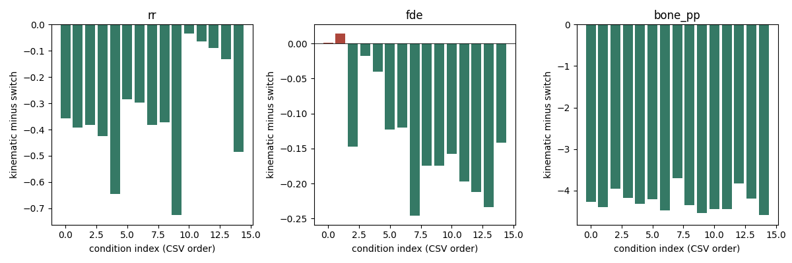

# Phase 2 · 저장된 T4 예측의 CPU 재평가

**사전 전체 판정 FAIL (8/15 통과)**. 조건을 동일 가중한 평균이다. 같은 프레임이 오염 조건마다 반복되므로 1,170개 독립 표본으로 해석할 수 없다. 새 모델 학습·GPU 재추론은 수행하지 않았다. 조건별 원자료는 results/ 아래에 있다.

| 정책 | Global JPE | RR JPE | FDE | Bone distortion (%p) | fast motion (%) |
|---|---:|---:|---:|---:|---:|
| control | 15.5064 | 13.3592 | 2.3229 | 23.400 | 127.1 |
| improved | 15.3344 | 13.7721 | 2.3027 | 18.225 | 126.2 |
| switch | 15.4632 | 13.4438 | 2.3984 | 22.621 | 129.7 |
| ema | 15.5061 | 13.3934 | 2.2795 | 23.163 | 118.3 |
| kinematic | 15.5137 | 13.1055 | 2.2670 | 18.357 | 126.8 |

## Oracle 상한

Global JPE를 미리 알고 매 프레임 선택하면 평균 15.3139. 각 조건의 더 좋은 단일 모델 대비 추가 이득은 평균 0.0204 raw, 범위 0.0000–0.0601다. 그러나 FDE는 2.3824로 증가했다. RR Oracle은 평균 13.3539, Control 대비 조건별 이득 0.0000–0.0307다. 전환 비용 DP는 JPE 15.3286, FDE 2.3035. DP의 최적성은 설계 문서의 결합 목적함수에 한한다.

## 오염 탐지와 유익한 보정

Improved가 Global JPE를 줄인 경우는 오염 프레임 182/198, 비오염 프레임 836/972였다. 기존 게이트가 켠 프레임은 179/211, 끈 프레임도 839/959에서 Improved가 유리했다. 깨끗한 조건의 빠른 프레임에서는 48/59였다. 오염 여부만으로 어느 경로가 Global JPE를 줄일지 구분하기 어렵고 RR 목적과도 일치하지 않는다.

Gunplay clean의 동일 전환 시점에서 FDE는 Control 1.961, Improved 1.977, hard switch 3.126, 새 보정 1.858 raw였다. 경로 전환 시 변위에는 현재 모델의 실제 프레임 간 변화와 직전 프레임의 두 모델 자세 차이가 함께 들어간다. 이 비교는 그 불연속이 관측된 사례다.

## 새 보정의 효과와 실패

Control 대비 RR JPE 감소 11/15, FDE 감소 12/15, 골격 왜곡 감소 15/15. 비오염 프레임에서도 하나 이상의 관절을 수정한 비율은 평균 100%였고, 비오염 프레임의 Global JPE 악화 비율은 평균 43.1%였다. 연결별 제한이 있어도 프레임 수준에서는 선택적이지 않았다. Opening jitter에서는 hard switch 대비 FDE가 0.0140 raw 악화됐다. Joyful jitter frame 24에서는 RR JPE가 1.2766 raw 악화됐다. 빠른 동작 보존은 평균 속도 비율만으로 보장되지 않는다.

CPU 후처리 관측 평균 0.120 ms/frame (NumPy 단일 실행, 입출력·teacher 제외). T4 전체 시스템 latency 또는 계산 절감 효과는 미측정이다. 새 validation은 출처와 중복을 확인한 실물이 없어 추가하지 않았다. 세 기존 validation 결과만 보고한다.

## 재현

GUIDE: 저장소 루트에서 아래 명령을 실행한다. 입력 ZIP을 푼 inputs/ 디렉터리와 원본 candidate/joyful57.npz가 필요하다. candidate가 없으면 기존 bone_length_loss_20261117.prepare_candidate 모듈에 입력 ZIP의 poses/와 새 candidate/ 경로를 전달한다.

```bash
python -m experiments.final_m2.kinematic_phase2.evaluate --archive REWIND_M2_Selective_T4_20261121_VERIFIED.zip --inputs inputs --candidate candidate/joyful57.npz --out new_results
python -m unittest experiments.final_m2.kinematic_phase2.test_phase2 -v
```

결과 ZIP SHA256 6d8e29d88a4e6b1735244b5f302ecf26159841b87d3c7c7a39871312a32d82ee와 내부 FILE_SHA256 전체를 대조했다. 별도 인계 보고서도 ZIP 내부와 바이트 일치했다. Train300/Opening/Gunplay/Joyful 입력 SHA는 기존 T4 summary와 일치한다. NPZ 15개의 Body22 shape, 유한성, 관절 mask, frame ID, GT, edge, hard-switch 선택과 corruption label을 대조했다. NPZ에 sequence_id 필드가 없어 고정 split·단일 sequence 입력과 GT/ID 대조로 식별했다. 원본 checkpoint는 이 분석에 필요하지 않았다.

results/policies.csv는 정책별 전체 지표, oracle.csv는 GT 기반 사후 상한, benefit.csv는 탐지·보정 관련 집계, frames.csv는 개별 프레임 비교다. 비교 그림의 x축은 policies.csv의 split/condition 순서다. 단위는 기존 raw이며 FPS·개인별 기준 신체 길이·원본 mocap 독립성은 미확인이다.


