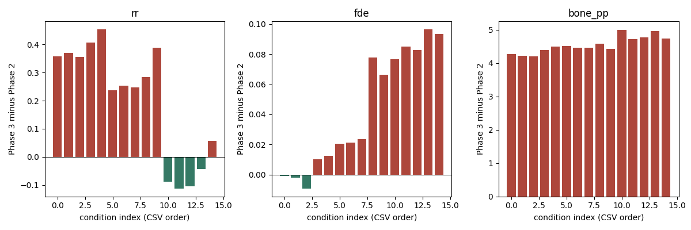

# Phase 3 — 저장된 Control800 예측의 연결별 보정

사전 전체 판정 **FAIL**. 15개 조건을 동일 가중했다. 같은 동작 프레임을 오염 조건별로 반복 사용했다.

| policy   |     jpe |      rr |   pelvis |    fde |   bone_pp |   motion |   rr_motion |   spread |   fast_motion_pct |   uncorrupted_active |   uncorrupted_harmful |   harmful |   cpu_ms |
|:---------|--------:|--------:|---------:|-------:|----------:|---------:|------------:|---------:|------------------:|---------------------:|----------------------:|----------:|---------:|
| control  | 15.5064 | 13.3592 |   5.7283 | 2.3229 |   23.4005 |  162.932 |     169.224 |  112.635 |           127.123 |               0      |                0      |    0      | nan      |
| fixed    | 15.4739 | 13.3126 |   5.7283 | 2.3167 |   22.7532 |  162.914 |     169.139 |  112.616 |           127.188 |               0.3476 |                0.1915 |    0.1796 |   0.5073 |
| improved | 15.3344 | 13.7721 |   4.6658 | 2.3027 |   18.2251 |  161.605 |     168.133 |  114.435 |           126.2   |               1      |                0.1959 |    0.1738 | nan      |
| off      | 15.5064 | 13.3592 |   5.7283 | 2.3229 |   23.4005 |  162.932 |     169.224 |  112.635 |           127.123 |               0      |                0      |    0      |   0.5061 |
| on       | 15.4497 | 13.1941 |   5.7283 | 2.3027 |   21.095  |  161.865 |     167.421 |  112.439 |           125.733 |               1      |                0.4261 |    0.3896 |   0.5392 |
| phase2   | 15.5137 | 13.1055 |   5.7283 | 2.267  |   18.3571 |  162.431 |     168.038 |  113.197 |           126.838 |               1      |                0.431  |    0.3935 |   0.1174 |
| phase3   | 15.4688 | 13.3096 |   5.7283 | 2.3106 |   22.9077 |  162.143 |     168.077 |  112.541 |           126.726 |               0.3528 |                0.1631 |    0.1533 |   0.5395 |
| switch   | 15.4632 | 13.4438 |   5.519  | 2.3984 |   22.6213 |  165.945 |     174.389 |  112.962 |           129.728 |               0.1103 |                0.0398 |    0.0414 | nan      |
| temporal | 15.4716 | 13.3151 |   5.7283 | 2.3124 |   22.9901 |  162.168 |     168.078 |  112.531 |           126.74  |               0.3268 |                0.1718 |    0.1668 |   0.561  |

clean fast 이동량의 100% 절대편차(세 동작 평균)는 15.45 → 16.10%p. Control 대비 Phase 2 개선 폭 중 유지한 비율은 RR 19.5%, FDE 21.9%, 골격 왜곡 9.8%다. 세 지표 각각 25% 이상이어야 하는 조건과 clean fast 조건을 충족하지 못했다.

## 동작별 비교

|                                          |     jpe |      rr |    fde |   bone_pp |   uncorrupted_active |   uncorrupted_harmful |
|:-----------------------------------------|--------:|--------:|-------:|----------:|---------------------:|----------------------:|
| ('gunplay47', 'control')                 | 19.4831 | 17.4036 | 1.9649 |   24.6409 |               0      |                0      |
| ('gunplay47', 'phase2')                  | 19.4635 | 17.0669 | 1.9059 |   19.67   |               1      |                0.7555 |
| ('gunplay47', 'phase3')                  | 19.4343 | 17.3489 | 1.9478 |   24.1636 |               0.431  |                0.1619 |
| ('opening130', 'control')                | 10.2976 |  8.9902 | 1.3209 |   21.8444 |               0      |                0      |
| ('opening130', 'phase2')                 | 10.0327 |  8.5437 | 1.3079 |   17.2057 |               1      |                0      |
| ('opening130', 'phase3')                 | 10.2412 |  8.9327 | 1.3099 |   21.5246 |               0.1187 |                0      |
| ('unused_motion_preselected', 'control') | 16.7384 | 13.6838 | 3.6827 |   23.7162 |               0      |                0      |
| ('unused_motion_preselected', 'phase2')  | 17.045  | 13.7058 | 3.5872 |   18.1955 |               1      |                0.5375 |
| ('unused_motion_preselected', 'phase3')  | 16.7308 | 13.6473 | 3.6741 |   23.0349 |               0.5088 |                0.3274 |

아래 표는 clean 조건의 빠른 프레임 이동량 비율(%). 100에 가까울수록 GT 크기에 가깝다.

| policy   |   gunplay47 |   opening130 |   unused_motion_preselected |
|:---------|------------:|-------------:|----------------------------:|
| control  |      94.037 |       96.057 |                      61.304 |
| phase2   |      93.954 |       97.845 |                      61.851 |
| phase3   |      94.147 |       96.057 |                      61.506 |

## 필요성 점수와 유익한 보정

적용되지 않은 연결도 평가하려고 동일한 sequence prior에서 gate를 항상 켠 정책을 반사실 비교로 사용했다. 각 연결의 child JPE가 Control보다 낮은 경우를 이득으로 센다. 부모에서 받은 이동도 포함하므로 해당 연결만 수정했을 때의 인과효과로 볼 수 없다. 이전 offset이 해제되는 동안 점수 1 이하에서도 일부 수정량이 남는다.

| above_threshold   |     n |   on_child_benefits |   on_child_harms |   corrected |   benefit_rate |   harm_rate |
|:------------------|------:|--------------------:|-----------------:|------------:|---------------:|------------:|
| False             | 22945 |                6614 |             8052 |         459 |         0.2883 |      0.3509 |
| True              |  1625 |                1233 |              392 |        1625 |         0.7588 |      0.2412 |

Phase 2 오류 조건 비교. 비율은 프레임 관측 단위이며 정책 표의 조건 동일가중 평균과 구분한다.

|        |   p2_harm |   p3_harm |   local_edges |
|:-------|----------:|----------:|--------------:|
| (0, 0) |    0.259  |    0.0457 |        0.7188 |
| (0, 1) |    0.352  |    0.304  |        1.588  |
| (1, 0) |    0.1503 |    0.0523 |        5.9542 |
| (1, 1) |    0.0889 |    0.1333 |        5.7111 |

대표 사례는 Phase 3가 Phase 2보다 Global JPE를 가장 많이 개선·악화시킨 프레임을 사후 선택했다.

| split                     | condition     |   frame |   dirty |   fast |   max_score |   local_edges |   phase2_jpe_delta |   phase3_jpe_delta | selected_children   |   p3_minus_p2 |
|:--------------------------|:--------------|--------:|--------:|-------:|------------:|--------------:|-------------------:|-------------------:|:--------------------|--------------:|
| unused_motion_preselected | clean         |      26 |       0 |      0 |       1.293 |             4 |              1.388 |              0.008 | 9 17 20 21          |        -1.379 |
| gunplay47                 | short_missing |       4 |       1 |      0 |       2     |             7 |             -0.914 |             -0.226 | 6 7 8 9 11 12 13    |         0.688 |

## 신체 비율 진단

오프라인 GT와 Train prior의 연결별 절대 편차 평균은 Opening/Gunplay/Joyful 모두 약 6.91%다. 이 세 표본에서는 Joyful만의 RR 악화를 개인 비율 차이로 설명할 근거가 없다. 시퀀스 prior는 신뢰한 시점의 예측 길이를 이용해 완만하게 업데이트하므로 모델 고유의 왜곡도 흡수할 수 있다. GT2D와 zero-camera에서 절대 신체 길이 식별은 미검증이다. 평가 GT는 진단에만 썼다.

## 재현 및 범위

실행 규칙은 DESIGN.md와 결과 전 커밋 0dc392e에 고정했다. 데이터·모델 코어는 Phase 2와 동일하다. 15개 evidence NPZ의 shape·GT·mask·ID·edge와 원래 hard-switch 선택, corruption label을 검증했다. 결과 ZIP 전체 SHA 및 내부 FILE_SHA256, 기존 T4 summary와 4개 입력 NPZ SHA를 대조했다. 두 checkpoint SHA는 evidence/frozen_checksums 및 summary의 과거 검증 기록과 대조했다. 이번 CPU 분석에서 checkpoint 바이트를 다시 로드하거나 직접 해싱하지 않았다.

```bash
python -m experiments.final_m2.kinematic_phase3.evaluate --archive REWIND_M2_Selective_T4_20261121_VERIFIED.zip --inputs inputs --candidate candidate/joyful57.npz --out new_results
python -m unittest experiments.final_m2.kinematic_phase3.test_gate experiments.final_m2.kinematic_phase2.test_phase2 -v
```

측정 시간은 CPU 후처리 단일 실행으로 특징 추출·연결별 선택·자손 이동을 포함하며 teacher 추론을 제외한다. CPU 검증은 Phase 3 5개, Phase 2 6개, 기존 M2 10개다. 이미 관찰한 세 validation을 재사용했고 신규 motion test는 확보하지 않았다. 실제 RGB frontend와 카메라 변화에 대한 일반화는 미검증이다. 이번 저장 예측 비교에 추가 Work T4 실행은 필요하지 않다.


